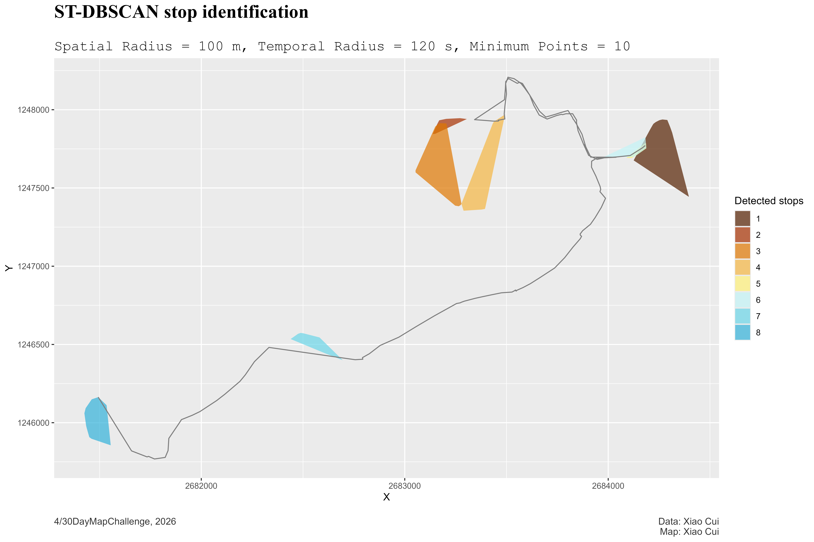
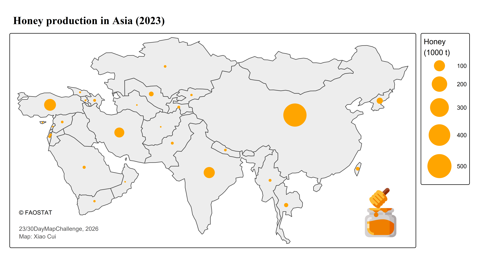

```{r pre}
#| code-summary: "load packages"
#| code-fold: true
#| code-line-numbers: false
library(sf)
library(terra)
library(dplyr)
library(mapview)
library(tmap)
library(ggplot2)
library(geogrid)
library(maptiles)
library(raster)
library(tmap.networks)
library(sfnetworks)
library(tidyr)
library(tmaptools)
library(tmap.cartogram)
library(tidyverse)
library(rnaturalearth)
library(geodata)
library(gstat)
```

# Points

```{r day1pre}
#| code-summary: "load data"
#| code-fold: true
#| code-line-numbers: false
doctors_sf <- base::readRDS("data/doctors_sf.rds")
```

```{r day1mapping}
#| code-summary: "Mapping"
#| code-fold: true
#| code-line-numbers: false
tmap_mode("plot")

tm_basemap("OpenStreetMap") +
  tm_title("Number of doctors in the Netherlands \nper province (NUTS2 region) in 2017", fontfamily = "serif")+
  tm_shape(doctors_sf) +
  tm_polygons(
    fill = NA,
    col = "grey60",
    lwd = 1,
    fill_alpha = 0.5
  ) +
  tm_symbols(
    size = "Doctors",
    shape =19,
    fill = "#008B8B",
    col = "black",
    lwd = 1,
    size.scale = tm_scale(values.scale = 3),
    fill.legend = tm_legend(position = c("right", "center"))
  )  +
  tm_compass(
    type = "arrow",
    position = c("left", "top")
  ) +
  tm_scalebar(
    position = c("left", "bottom")
  ) +
  tm_credits(
    "© Statistics Netherlands (CBS)",size = 0.5,
    position = c("left", "bottom"), bg = TRUE
  )+
  tm_credits(
    "\n1/30DayMapChallenge, 2026",size = 0.6,color = "grey30",
    position = c("left", "bottom"), bg = TRUE
  ) + 
  tm_credits(
    "Map: Xiao Cui",color = "grey30",size = 0.6,
    position = c("left", "bottom"), bg = TRUE
  ) +tm_options(component.autoscale = FALSE)
```

# Lines

```{r day2pre}
#| code-summary: "load data"
#| code-fold: true
#| code-line-numbers: false
grid_us_sf <- sf::st_read("data/ne_110m_graticules_10.shp")
line_100W_sf <- grid_us_sf |>
  dplyr::filter(display == "100 W")
ppt_2025_rs <- terra::rast("data/prism_ppt_us_30s_2025.tif")
```

```{r day2mapping}
#| code-summary: "Mapping"
#| code-fold: true
#| code-line-numbers: false
tmap_mode("plot")

# 1. Define precipitation intervals
my_breaks <- c(
  0, 200, 400, 600, 800,
  1000, 1500, 2000, 3000, Inf
)

# 2. Define legend labels
my_labels <- c(
  "0–200",
  "200–400",
  "400–600",
  "600–800",
  "800–1000",
  "1000–1500",
  "1500–2000",
  "2000–3000",
  "> 3000"
)

# 3. Define colors
my_cols <- hcl.colors(
  length(my_breaks) - 1,
  palette = "Spectral",
  rev = FALSE
)

# 4. Create map
map_ppt <-
  tmap::tm_shape(ppt_2025_rs) +
  tm_title("What does 'The 100th meridian' mean for the U.S.?", fontfamily = "serif") +
  tmap::tm_raster(
    col.scale = tmap::tm_scale_intervals(
      style = "fixed",
      breaks = my_breaks,
      values = my_cols,
      labels = my_labels,
      interval.closure = "left"
    ),
    col.legend = tmap::tm_legend(
      title = "Total annual\nprecipitation (in.),\n2025",
      title.size = 0.7,
      text.size = 0.7,
      bg.color = "white",
      bg.alpha = 0.6,
      position = tmap::tm_pos_in("left", "bottom"),
      frame = TRUE
    )
  ) +
  tmap::tm_graticules(
    labels.size = 0.7
  ) +
  tmap::tm_compass(
    position = tmap::tm_pos_in("right", "top")
  ) +
  tmap::tm_shape(line_100W_sf) +
  tmap::tm_lines(
    lwd = 6,
    col = "black"
  ) +

  # Manually add the 100th meridian legend
  tmap::tm_add_legend(
    type = "lines",
    labels = "100th meridian",
    col = "black",
    lwd = 6,
    title = "",
    title.size = 1,
    text.size = 1,
    bg.color = "white",
    bg.alpha = 0.7,
    position = tmap::tm_pos_in("right", "bottom"),
    frame = TRUE
  ) +tm_credits(
    "© NACSE",size = 0.7,
    position = c("left", "bottom"), bg = TRUE
  )+
  tm_credits(
    "\n2/30DayMapChallenge, 2026",size = 0.7,color = "grey30",
    position = c("right", "bottom"), bg = TRUE
  ) + 
  tm_credits(
    "Map: Xiao Cui",color = "grey30",size = 0.7,
    position = c("right", "bottom"), bg = TRUE
  )+

  tmap::tm_layout(
    scale = 1.0
  )

# Display
map_ppt
```

# Polygons

```{r day3pre}
#| code-summary: "load data"
#| code-fold: true
#| code-line-numbers: false
cape_sf <- sf::st_read("data/protected-areas.gpkg") |>
  dplyr::filter(name == "Cape Rodney-Okakari Point Marine Reserve")
```

```{r, echo=FALSE}
library(maptiles)
Sys.setenv(STADIA_MAPS = "765ffa8b-5075-4148-8a6d-3f1fd7858c52")
```

```{r day3mapping}
#| code-summary: "Mapping"
#| code-fold: true
#| code-line-numbers: false
tmap_mode("plot")

tm_basemap("Stadia.StamenWatercolor") +
  tm_title("Cape Rodney-Okakari Point Marine Reserve and its interior ring", fontfamily = "serif") +
  tm_shape(cape_sf) +
  tm_polygons(
    fill = NA,
    col = "grey70",
    lwd = 1,
    fill_alpha = 0.5
  ) +
  tm_borders(alpha = 0.2) +
  tmap::tm_graticules(
    labels.size = 0.5, crs = 27200
  ) +
  tm_text(text = "Cape Rodney-Okakari \nPoint Marine Reserve", size = 1, col = "grey20", xmod = 1.2, ymod = 2.2) +tm_credits(
    "© LINZ",size = 0.7,
    position = c("left", "bottom"), bg = TRUE
  )+
  tm_credits(
    "\n3/30DayMapChallenge, 2026",size = 0.7,color = "grey30",
    position = c("left", "bottom"), bg = TRUE
  ) + 
  tm_credits(
    "Map: Xiao Cui",color = "grey30",size = 0.7,
    position = c("left", "bottom"), bg = TRUE
  )
```

# Clusters

```{r, day4mapping, eval = FALSE}
#| code-summary: "mapping"
#| code-fold: true
#| code-line-numbers: false
ggplot() +
  geom_point() +
  geom_polygon(data = hull_data, aes(X_lv95, Y_lv95, fill = clust), alpha = 0.7) +
  scale_fill_manual(values = MetBrewer::met.brewer("Homer1", 8)) +
  geom_path(data = subset_df_mvt, aes(X_lv95, Y_lv95),color="grey50")  +
  labs(x = "X", y = "Y", fill = "Detected stops",
    title = "ST-DBSCAN stop identification",
    subtitle = "\nSpatial Radius = 100 m, Temporal Radius = 120 s, Minimum Points = 10",
    caption = c("\n4/30DayMapChallenge, 2026", "\nData: Xiao Cui\nMap: Xiao Cui"
  )) +
  theme(plot.title = element_text(family = "serif", face = "bold", size = 20),
        plot.subtitle = element_text(family = "mono", size = 15),
        plot.caption = element_text(size = 10, color = "grey20",hjust = c(0, 1)))
```

{#fig-diagram fig-alt="Day 4" width=80%}

# Senses: Sight

```{r day5pre}
#| code-summary: "load data"
#| code-fold: true
#| code-line-numbers: false
point_montmartre_df <- data.frame(
  id = 1,
  lon = 2.343121,
  lat = 48.886452
)

point_montmartre_sf  <- sf::st_as_sf(
  point_montmartre_df,
  coords = c("lon", "lat"),
  crs = 4326
)

bg_tiles <- maptiles::get_tiles(x = point_montmartre_sf, provider = "Esri.WorldImagery", zoom = 19)
```

```{r day5mapping}
#| code-summary: "mapping"
#| code-fold: true
#| code-line-numbers: false
tm_shape(bg_tiles) +
    tm_rgb(options = opt_tm_rgb(interpolate = FALSE, saturation = 2)) +
tm_title("Snapshot: Montmartre, Paris", fontfamily = "serif", fontface = "bold") +
  tm_graticules(lines = F) +tm_credits(
    "© Esri.WorldImagery",size = 0.8,color = "grey10",
    position = c("right", "bottom"), bg = TRUE
  )+
  tm_credits(
    "\n5/30DayMapChallenge, 2026",size = 0.6,color = "grey30",
    position = c("right", "bottom"), bg = TRUE
  ) + 
  tm_credits(
    "Map: Xiao Cui",color = "grey30",size = 0.6,
    position = c("right", "bottom"), bg = TRUE
  ) +

  tmap::tm_layout(
    scale = 1.1
  )
```

# Vintage

```{r day6pre}
#| code-summary: "load data"
#| code-fold: true
#| code-line-numbers: false
ghent_buildings <- base::readRDS("data/ghent_buildings.rds")
ghent_buildings_multi <- base::readRDS("data/ghent_buildings_multi.rds")
```

```{r day6mapping}
#| code-summary: "mapping"
#| code-fold: true
#| code-line-numbers: false
tmap_mode("plot")

tm_shape(ghent_buildings_multi) +
  tm_polygons(fill = "coral4") +
  tm_shape(ghent_buildings) +
  tm_polygons(
    fill = "coral1") +
    tmap::tm_grid(labels.show = FALSE
    ) +
   tm_layout(
    bg.color = "#f4f1ea",          # Cream/off-white stamp paper background
    outer.bg.color = "#d9d2c9",    # Darker background outside the stamp
    frame = TRUE,                  # Turn on the map frame
    frame.lwd = 2,                 # Thick frame border
    frame.color = "#333333",       # Dark charcoal border color
    frame.double_line = TRUE,
    scale = 1.1
  ) +
  tm_title("Imitated Ferraris map: the old city centre of Ghent, Belgium",fontface = "bold",fontfamily = "serif",size = 1.2)+
  tm_title("6/30DayMapChallenge, 2026\nMap: Xiao Cui", size = 0.8, color = "grey40",fontfamily = "serif") +
  tm_credits(
    "© OSM",size = 0.5,color = "grey10",
    position = c("right", "bottom"), bg = FALSE,fontfamily = "serif"
  ) 
```

# 10 minute map

```{r day7pre}
#| code-summary: "load data"
#| code-fold: true
#| code-line-numbers: false
South_America <- World[World$continent == "South America", ]
South_America <- South_America |>
  dplyr::rename(IncomeGroup = income_grp)
```

```{r day7mapping}
#| code-summary: "mapping"
#| code-fold: true
#| code-line-numbers: false
tmap_mode("plot")

tm_shape(South_America) +
tm_title("Income Group, South America, 2024", fontfamily = "serif", fontface = "bold") +
  tm_polygons(fill = "IncomeGroup", fill.scale = tm_scale_categorical(values = "-brewer.yl_or_br"), fill_alpha = 0.9) +
  tm_text("name", size = 0.8, options = opt_tm_text(remove_overlap = FALSE))  +tm_credits(
    "© NED",size = 0.8,color = "grey10",
    position = c("right", "bottom"), bg = TRUE
  )+
  tm_credits(
    "7/30DayMapChallenge, 2026",size = 0.6,color = "grey30",
    position = c("right", "bottom"), bg = TRUE
  ) + 
  tm_credits(
    "Map: Xiao Cui",color = "grey30",size = 0.6,
    position = c("right", "bottom"), bg = TRUE
  ) +

  tmap::tm_layout(
    bg.color = "lightblue",scale = 1.1
  ) +tm_options(component.autoscale = FALSE)
```

# Utopia

```{r day8pre}
#| code-summary: "load data"
#| code-fold: true
#| code-line-numbers: false
world_union <- sf::st_union(World)
```

```{r day8mapping}
#| code-summary: "mapping"
#| code-fold: true
#| code-line-numbers: false
tmap_mode("plot")
tm_shape(world_union) +
    tm_polygons(fill = "whitesmoke") +
  tm_shape(World_rivers) +
    tm_lines(lwd = "strokelwd", col = "lightblue",
             lwd.scale = tm_scale_asis(values.scale = 0.2))  +
tm_crs("+proj=eck4")  + 
tm_layout(earth_boundary = TRUE,
          earth_boundary.lwd = 2,
          legend.show = FALSE,     # option to disable all legends
          frame = FALSE,
          space.color = "white", bg.color = "dodgerblue")  +tm_credits(
    "© tmap",size = 0.8,color = "grey10",
    position = c("right", "bottom"), bg = TRUE) +
  tm_title("A Utopia could be a real world without prejudice.", fontfamily = "serif", fontface = "bold") +
  tm_title("\n8/30DayMapChallenge, 2026\nMap: Xiao Cui", size = 0.8, color = "grey40",fontfamily = "serif") +
  tmap::tm_layout(
    scale = 1.1
  )
```

# Urban-rural

```{r day9pre}
#| code-summary: "load data"
#| code-fold: true
#| code-line-numbers: false
# load raw data
GHS_SMOD_vienna <- terra::rast("data/GHS-SMOD-Vienna-2025-2030.tif")
# Convert 0 to NA
GHS_SMOD_vienna_clean <- terra::ifel(
  GHS_SMOD_vienna == 0,
  NA,
  GHS_SMOD_vienna
)
# Trim the raster extent to valid cells
GHS_SMOD_vienna_clean <- terra::trim(
  GHS_SMOD_vienna_clean
)
# Define categories
smod_classes <- data.frame(
  ID = c(11, 12, 13, 21, 30),
  Class = c(
    "Very low density rural",
    "Low density rural",
    "Rural cluster",
    "Suburban",
    "Urban centre"
  )
)
# Assign categories
GHS_SMOD_vienna_clean <- terra::as.factor(
  GHS_SMOD_vienna_clean
)
levels(GHS_SMOD_vienna_clean) <- smod_classes

# Extract the current extent (bounding box)
e <- ext(GHS_SMOD_vienna_clean)
# Expand by a scale factor (e.g., multiply the width and height by 1.1)
e_expanded <- e * 1.1
# Convert to a SpatVector polygon, then to an sf object
sf_extent <- st_as_sf(vect(e_expanded, crs = "EPSG:3416"))
```

```{r day9mapping}
#| code-summary: "mapping"
#| code-fold: true
#| code-line-numbers: false
tmap_mode("plot")

tm_shape(GHS_SMOD_vienna_clean, bbox = sf_extent) + tm_title("Is everywhere urban for Vienna?", fontfamily = "serif", fontface = "bold") + 
  tm_title("\nAn insight from Global Human Settlement Layer (GHSL) Settlement Model (SMOD), 2025-2030", fontfamily = "serif", size = 0.8) + tm_basemap("OpenStreetMap.DE") +
  tm_raster(col_alpha = 0.5,palette = "Set1",
    col.legend = tm_legend("GHS-SMOD classification",
      show = TRUE
    )
  ) +
  tm_layout(
    frame = TRUE,
    legend.outside = TRUE
  ) +
  tm_grid(lines = T) +
tm_crs(3416) +tm_credits(
    "© GAUL | GHSL | GEE | OSM",size = 0.5,
    position = c("right", "bottom"), bg = TRUE
  )+
  tm_credits(
    "9/30DayMapChallenge, 2026",size = 0.5,color = "grey30",
    position = c("right", "bottom"), bg = TRUE
  ) + 
  tm_credits(
    "Map: Xiao Cui",color = "grey30",size = 0.5,
    position = c("right", "bottom"), bg = TRUE
  ) + tm_options(component.autoscale = FALSE)
```

# Prompting only

> **Create image** Please create a map for me to show one-day daily temperature at the community level of Poland. Please generate the title according to the date of observation. There is no restriction for the color scheme in the legend, but it should be color-blind- friendly.
Consider the purpose of this map is for weather forecasting torwards the public, please choose the style for the coordinate system, north narrow, and scale bar accordingly. Please mark the data source at the left bottom of the map. Finally, please add the following three-line credits on the right bottom of the map in dark grey: "10/30DayMapChallenge, 2026", "Map: ChatGPT `your version`", "Prompts: Xiao Cui".

{width=80%}

# Senses: Sound
```{r, day11mapping, eval = FALSE}
#| code-summary: "mapping"
#| code-fold: true
#| code-line-numbers: false
tmap_mode("plot")

tm_shape(bbox) +
  tm_polygons(
    fill = "grey50",
    col = NA
  ) +
  tm_shape(livehouses) +
  tm_symbols(
    fill = "yellow",
    size = 1,
    col = "#FFF4A3",
    lwd = 2, fill.legend = tm_legend("Night clubs", show = TRUE)
  ) +
  tm_layout(
    bg.color = "grey20",
    outer.bg.color = "grey20",
    frame = FALSE
  ) +
  tm_title(
    "Where are night clubs in Seoul?",
    color = "#FFFFFF",
    position = tm_pos_out("center", "top")
  ) +tm_options(component.autoscale = TRUE) +tm_credits(
    "© OSM",size = 0.8,color = "white",
    position = c("left", "bottom"), bg = FALSE
  )+
  tm_credits(
    "\n11/30DayMapChallenge, 2026",size = 0.6,color = "white",
    position = c("left", "bottom"), bg = FALSE
  ) + 
  tm_credits(
    "Map: Xiao Cui",color = "white",size = 0.6,
    position = c("left", "bottom"), bg = FALSE
  )
```

{width=80%}

# Power
```{r day12pre}
#| code-summary: "load data"
#| code-fold: true
#| code-line-numbers: false
# load data
boundary_sg_sf <- readRDS("data/boundary_sg_sf.rds")
school_sg_sf <- readRDS("data/school_sg_sf.rds")
# bbox for inset map: CR
bb_centre <- tmaptools::bb(boundary_sg_sf[boundary_sg_sf$REGION_C == "CR",], ext = 1.0)
# inset plot
gg1 <- ggplot(boundary_sg_sf, aes(REGION_C, n_schools)) + 
  geom_col() +
  scale_y_continuous(labels = scales::comma) +
  labs(x = NULL, y = "Count") +
  theme_minimal() + labs(title = "Number of schools\nper region") +
  theme(plot.title = element_text(size = 8),axis.title = element_text(size = 7), axis.text = element_text(size = 5))
```

```{r day12mapping}
#| code-summary: "mapping"
#| code-fold: true
#| code-line-numbers: false
tmap_mode("plot")
tm_shape(boundary_sg_sf) +
  tm_polygons(fill = "grey90", fill_alpha = 0.5, col = "blue1")+ tm_basemap("Esri.WorldStreetMap") +
  tm_shape(school_sg_sf) +
tm_title("Schools of Singapore", fontfamily = "serif", fontface = "bold") +
  tm_title("Land Transport Authority (LTA), 2024", fontfamily = "serif", size = 1) +
  tm_polygons(fill = "black") + 
  tm_add_legend(
    type = "polygons",
    labels = "Schools",
    fill = "black",
    position = c("left", "top")
  ) + tm_scalebar(position = c("left", "top"), bg =FALSE) +
  tm_credits(
    "© data.gov.sg",size = 0.8,color = "grey10",
    position = c("right", "bottom"), bg = TRUE
  )+
  tm_credits(
    "\n12/30DayMapChallenge, 2026",size = 0.6,color = "grey30",
    position = c("right", "bottom"), bg = TRUE
  ) + 
  tm_credits(
    "Map: Xiao Cui",color = "grey30",size = 0.6,
    position = c("right", "bottom"), bg = TRUE
  ) +tm_options(component.autoscale = FALSE) + tm_title("CENTRAL REGION (CR)", group_id = 1, size = 0.7, bg = TRUE) + tm_inset(bb_centre, group_id = 1, height = 10, width = 10, main_frame = TRUE, main_frame.color = "red")  +
  tm_components(1, position = c("right", "top")) +
  tm_inset(gg1, position = c("left", "bottom")) 
```

# Interactions

The link of the interactive application: <https://ee-xiaocui.projects.earthengine.app/view/ndwiui30daymcxcui>

The link of the primary code used in the application: <https://code.earthengine.google.com/44a6e215b35db2cda0a30b683ef59134>

{width=80%}

# Borgesian map

The data can be downloaded at: <https://cms.geo.admin.ch/Topo/swisssurface3d/swissSURFACE3D_example.zip>

More information about swissSURFACE3D: <https://www.swisstopo.admin.ch/en/height-model-swisssurface3d>

{width=80%}

# Inside out

```{r day15pre}
#| code-summary: "load data"
#| code-fold: true
#| code-line-numbers: false
# Load world map data
world <- ne_countries(scale = "medium", returnclass = "sf")
# Define an inverted Cylindrical Equal Area (Peters) projection using +axis=wsu
inverted_crs <- "+proj=cea +lat_ts=45 +lon_0=0 +x_0=0 +y_0=0 +datum=WGS84 +units=m +no_defs +axis=wsu"
world_inverted <- st_transform(world, crs = inverted_crs)

# Load glaciers data
glaciers <- ne_download(
  scale = 50,
  type = "glaciated_areas",
  category = "physical",
  returnclass = "sf"
)
glaciers_inverted <- st_transform(glaciers, crs = inverted_crs)
# Add a categorical column
glaciers_inverted$legend_label <- "Glaciated Areas"
```

```{r day15mapping}
#| code-summary: "mapping"
#| code-fold: true
#| code-line-numbers: false
ggplot() + geom_sf(data = world_inverted, fill = "grey95", color = "white", linewidth = 0.2) +
  geom_sf(
    data = glaciers_inverted,
    aes(fill = legend_label),
    color = "steelblue",
    linewidth = 0.2,
    show.legend = TRUE
  ) +
  scale_fill_manual(
    name = NULL,
    values = c("Glaciated Areas" = "steelblue"),
    breaks = "Glaciated Areas",
    drop = FALSE
  ) +
  guides(
    fill = guide_legend(
      override.aes = list(
        color = "steelblue",
        linewidth = 0.2
      )
    )
  ) +
  theme_minimal() +
  theme(legend.text = element_text(family = "serif"),
    legend.position = "right"
  ) + coord_sf(
    datum = st_crs(inverted_crs)) +
  scale_x_continuous(labels = function(x) format(x, scientific = FALSE)) +
  scale_y_continuous(labels = function(x) format(x, scientific = FALSE)) +
  labs(x = "X", y = "Y", 
    title = "Antarctica: named from 'Anti Arctic'",
    subtitle = "But where is Arctic?",
    caption = c("\n15/30DayMapChallenge, 2026", "\n© rnaturalearth\nMap: Xiao Cui"
  )) +
  theme(plot.title = element_text(family = "serif", face = "bold", size = 20),
        plot.subtitle = element_text(family = "serif", size = 18),
        plot.caption = element_text(family = "serif", size = 10, color = "grey20",hjust = c(0, 1)))
```

# Collaborative map

```{r day16pre}
#| code-summary: "load data"
#| code-fold: true
#| code-line-numbers: false
boroughs <- base::readRDS("data/boroughs.rds")
```

```{r day16mapping}
#| code-summary: "mapping"
#| code-fold: true
#| code-line-numbers: false
tmap_mode("plot")

# Map 1: Custom legend
t1 <- tm_shape(boroughs) + tm_title("Population in London Boroughs (2025)") +
  tm_title("A collaborative map with me of the past", size = 0.9, color = "gold4") +
  tm_polygons(
    fill = "pop_per_km2",
    fill.scale = tm_scale_intervals(
      values = "brewer.yl_gn"
    ),
    fill.legend = tm_legend(
      title = "Population per km2",
      na.show = FALSE
    )
  ) +
  tm_credits(
    "© CityPopulation.DE & TFL London Boroughs",
    size = 0.5,
    color = "grey10",
    position = c("left", "bottom"),
    bg = TRUE
  ) +
  tm_credits(
    "\n16/30DayMapChallenge, 2026",
    size = 0.5,
    color = "grey30",
    position = c("right", "bottom"),
    bg = TRUE
  ) +
  tm_credits(
    "Map: Xiao Cui (2024 & current)",
    color = "grey30",
    size = 0.5,
    position = c("right", "bottom"),
    bg = TRUE
  )  + tm_options(component.autoscale = FALSE)

# Map 2: Hide legend completely
t2 <- tm_shape(boroughs) +
  tm_polygons(
    fill = "pop_per_km2",
    fill.scale = tm_scale_intervals(
      values = "brewer.yl_gn"
    ),
    fill.legend = tm_legend_hide()
  ) +
  tm_facets_wrap(
    "borough",
    nrow = 4,
    ncol = 8
  )  + tm_options(component.autoscale = FALSE)

# Combine maps
tmap_arrange(t1, t2, ncol = 1)
```

# Light & dark

```{r, day17mapping, eval = FALSE}
#| code-summary: "mapping"
#| code-fold: true
#| code-line-numbers: false
tmap_mode("plot")

tm_shape(r) + tm_basemap("Esri.WorldStreetMap", alpha = 0.2) +
  tm_raster(
    col = names(r)[1],
    col.scale = tm_scale_continuous(
      values = c("black", "yellow"),
      midpoint = 100,
      value.na = "transparent"
    ),
    col.legend = tmap::tm_legend(
            title = "Nighttime light radiance",na.show = FALSE)
  ) + 
  tm_title(
    text = "Nighttime lights in Jordan: 2026.11.15",
    size = 1,
    fontface = "bold"
  ) +
  tm_layout(scale = 1, 
    frame = TRUE,
    inner.margins = c(0.1, 0.1, 0.1, 0.1),
    bg.color = "white",
    outer.bg.color = "white"
  )  +tm_credits(
    "© ESDS | BlackMarbleR",size = 0.6,
    position = c("left", "bottom"), bg = FALSE
  )+
  tm_credits(
    "\n17/30DayMapChallenge, 2026",size = 0.6,color = "grey30",
    position = c("right", "bottom"), bg = FALSE
  ) + 
  tm_credits(
    "Map: Xiao Cui",color = "grey30",size = 0.6,
    position = c("right", "bottom"), bg = FALSE) + tm_options(component.autoscale = FALSE)
```

{width=80%}

# NULL

```{r day18pre}
#| code-summary: "load data"
#| code-fold: true
#| code-line-numbers: false
roi_sf <- gadm(country = "ITA", level=1, path = tempdir())

# Convert DMS to decimal degrees
lat <- 44 + 24/60 + 36.46/3600
lon <- 8 + 55/60 + 31.86/3600

# Create sf point
point_sf <- data.frame(
  lon = lon,
  lat = lat
) |>
  st_as_sf(
    coords = c("lon", "lat"),
    crs = 4326
  )
point_sf <- point_sf |>
  dplyr::mutate(name = "GENOVA")
```

```{r, day18mapping}
#| code-summary: "mapping"
#| code-fold: true
#| code-line-numbers: false
tmap_mode("plot")

tm_basemap("Esri.WorldTerrain") +
  tm_title("Where we define vertical '0.00 m'\nin Italy?", fontfamily = "serif") +
  tm_shape(roi_sf) +
  tm_fill(
    fill = "grey60",
    fill_alpha = 0.5
  ) + 
  tm_borders(col = "grey60", lwd = 0.5, lty = "dashed") + 
  tm_shape(point_sf) + tm_symbols(shape = 23, fill = "blue")+
  tmap::tm_graticules(
    labels.size = 0.5, crs = 6875
  ) +
  tm_text(text = "The Port of Genova", size = 0.8, ymod = 1.2) +tm_credits(
    "© ISPRA",size = 0.9,
    position = c("left", "bottom"), bg = FALSE
  )+
  tm_credits(
    "\n18/30DayMapChallenge, 2026",size = 0.7,color = "grey30",
    position = c("right", "bottom"), bg = FALSE
  ) + 
  tm_credits(
    "Map: Xiao Cui",color = "grey30",size = 0.7,
    position = c("right", "bottom"), bg = FALSE
  )
```

# Senses: Smell
```{r day19pre}
#| code-summary: "load data"
#| code-fold: true
#| code-line-numbers: false

osmanthus_Hunan_sf <- base::readRDS("data/osmanthus_Hunan_sf.rds")
roi_hunan_sf <- base::readRDS("data/roi_hunan_sf.rds")

icon <- tmap_icons("data/pngwing.png", width = 10, height = 10)
```

```{r, day19mapping}
#| code-summary: "mapping"
#| code-fold: true
#| code-line-numbers: false
tmap_mode("plot")

tm_basemap("Esri.NatGeoWorldMap", alpha = 0.5) + tm_title("Where can you smell osmanthus in Hunan?", fontfamily = "serif") + 
  tm_shape(roi_hunan_sf) + tm_borders() +
tm_shape(osmanthus_Hunan_sf) +
  tm_symbols(shape = icon) +
  tm_graticules(crs = 4480) + tm_options(component.autoscale = FALSE) +tm_credits(
    "© GBIF",size = 0.9,
    position = c("left", "bottom"), bg = TRUE
  )+
  tm_credits(
    "\n19/30DayMapChallenge, 2026",size = 0.7,color = "grey30",
    position = c("left", "bottom"), bg = TRUE
  ) + 
  tm_credits(
    "Map: Xiao Cui",color = "grey30",size = 0.7,
    position = c("left", "bottom"), bg = TRUE
  ) + tm_scalebar(position = c("right", "bottom"), bg = FALSE)
```

# Hexagons

```{r day20mapping, eval = FALSE}
#| code-summary: "mapping"
#| code-fold: true
#| code-line-numbers: false
tgg1 <- tm_shape(roi_sf_l2) + tm_basemap("OpenTopoMap", alpha = 0.2) + tm_title("Adminstrative boundaries of Ireland", fontfamily = "serif", size = 1) + tm_title("original geography", fontfamily = "serif", color = "grey50", size = 0.9) +
  tm_borders(col = "grey10", lwd = 1.5)  + tm_options(component.autoscale = FALSE) + tm_layout(frame = FALSE)

tgg2 <- tm_shape(roi_hex_sf_l2) + tm_basemap("OpenTopoMap", alpha = 0.2) +tm_title("Hexagonal grid of Ireland", fontfamily = "serif", size = 1) + tm_title("preserving the original geography", fontfamily = "serif", size = 0.8, color = "grey50") +
  tm_borders(col = "grey10", lwd = 1.5) + tm_options(component.autoscale = FALSE) + tm_layout(frame = FALSE)

tgg3 <- tm_shape(clipped_grid_5k)  + tm_title("Hexagonal grid of Ireland", fontfamily = "serif", size = 1) + tm_title("5000-meter cell diameter (3724 cells)", fontfamily = "serif", size = 0.8, fontface = "bold") + tm_basemap("OpenTopoMap", alpha = 0.2) + 
  tm_borders(col = "grey10", lwd = 0.9)  + tm_options(component.autoscale = FALSE) + tm_layout(frame = FALSE)

tgg4 <- tm_shape(clipped_grid_2k) + tm_basemap("OpenTopoMap", alpha = 0.2) +
  tm_borders(col = "grey10", lwd = 0.9) + tm_title("Hexagonal grid of Ireland", fontfamily = "serif", size = 1) + tm_title("2000-meter cell diameter (21794 cells)", fontfamily = "serif", size = 0.8, fontface = "bold") + tm_options(component.autoscale = FALSE) + tm_credits(
    "\n20/30DayMapChallenge, 2026",size = 0.5,color = "grey30",
    position = c("right", "bottom"), bg = FALSE
  ) + 
  tm_credits(
    "Map: Xiao Cui",color = "grey30",size = 0.5,
    position = c("right", "bottom"), bg = FALSE
  ) + tm_layout(frame = FALSE)

tmap_arrange(tgg1, tgg2, tgg3, tgg4, ncol = 2)
```

{#fig-diagram fig-alt="Day 20" width=80%}

# OpenStreetMap
```{r day21pre}
#| code-summary: "load data"
#| code-fold: true
#| code-line-numbers: false
GS_macao <- sf::st_read("data/export_macao.geojson") |>
  filter(st_geometry_type(geometry) %in% c("POLYGON", "MULTIPOLYGON"))

GS_macao <- GS_macao |>
  unite(Type, c(landuse, leisure), sep = " ", remove = FALSE,
    na.rm = TRUE)
```

```{r, day21mapping}
#| code-summary: "mapping"
#| code-fold: true
#| code-line-numbers: false
tm_shape(GS_macao) + tm_basemap("OpenStreetMap", alpha = 0.3) +
  tm_polygons(
    fill = "Type",
    fill.scale = tm_scale_categorical(values = "matplotlib.yl_gn"),
    col = NA,
    fill.legend = tm_legend(position = tm_pos_out("right", "center"))
  ) + tm_title(
    "Green space in Macao",
    fontfamily = "serif",
    position = tm_pos_out("center", "top")
  ) +tm_options(component.autoscale = TRUE) +tm_credits(
    "© OSM",size = 0.8,color = "grey30",
    position = c("right", "bottom"), bg = FALSE
  )+
  tm_credits(
    "\n21/30DayMapChallenge, 2026",size = 0.6,color = "grey30",
    position = c("left", "bottom"), bg = FALSE
  ) + 
  tm_credits(
    "Map: Xiao Cui",color = "grey30",size = 0.6,
    position = c("left", "bottom"), bg = FALSE
  ) 
```

# Projections
```{r day22pre}
#| code-summary: "load data"
#| code-fold: true
#| code-line-numbers: false
Africa = World[World$continent == "Africa", ]
```

```{r, day22mapping}
#| code-summary: "mapping"
#| code-fold: true
#| code-line-numbers: false
tm_shape(Africa, crs = "+proj=robin") +
    tm_cartogram(size = "*pop_est", 
                 fill = "well_being",
                 fill.scale = tm_scale_intervals(values = "-hcl.green_orange"),
                 fill.legend = tm_legend("Well being\n(from 0 to 10)")
                 ) +
tm_title("Well being in Africa", fontfamily = "serif", fontface = "bold") +
  tm_title("A contiguous cartogram distorted by population", fontfamily = "serif", color = "grey40", size = 1) +tm_credits(
    "© HPI",size = 0.7,
    position = c("left", "bottom"), bg = TRUE
  )+
  tm_credits(
    "\n22/30DayMapChallenge, 2026",size = 0.7,color = "grey30",
    position = c("left", "bottom"), bg = TRUE
  ) + 
  tm_credits(
    "Map: Xiao Cui",color = "grey30",size = 0.7,
    position = c("left", "bottom"), bg = TRUE
  ) +tm_options(component.autoscale = FALSE)
```

# Senses: Taste

```{r day23mapping, eval = FALSE}
tm_shape(honey_fao_sf) + 
  tm_polygons(fill = "grey90",fill_alpha = 0.7)  + tm_title("Honey production in Asia (2023)", fontfamily = "serif",fontface = "bold") +
  tm_symbols(
    size = "Value",
    title = "1000 t",
    size.legend = tm_legend("Honey\n(1000 t)"),
    shape =19,
    fill = "orange",
    col = "black",
    lwd = 1,
    size.scale = tm_scale(values.scale = 3),
    fill.legend = tm_legend(position = c("right", "center"))
  ) + tm_credits(
    "© FAOSTAT",size = 0.7,
    position = c("left", "bottom"), bg = FALSE
  )+
  tm_credits(
    "\n23/30DayMapChallenge, 2026",size = 0.7,color = "grey30",
    position = c("left", "bottom"), bg = FALSE
  ) + 
  tm_credits(
    "Map: Xiao Cui",color = "grey30",size = 0.7,
    position = c("left", "bottom"), bg = FALSE
  ) + 
  tm_logo("data_23rd/honey.png",
          height = 5,position  = c("right", "bottom"))
```

{width=80%}

# Network

```{r day24pre}
#| code-summary: "load data"
#| code-fold: true
#| code-line-numbers: false
filtered_hamburg <- base::readRDS("data/filtered_hamburg.rds")
cut_nodes <- base::readRDS("data/cut_nodes.rds")
```

```{r, day24mapping}
#| code-summary: "mapping"
#| code-fold: true
#| code-line-numbers: false
tm_shape(filtered_hamburg) + tm_title("933 cut nodes in a\n1km-circular road network", fontfamily = "serif",fontface = "bold") + tm_edges(col = "highway", lwd = 1, col_alpha = 0.5) + tm_shape(cut_nodes) + tm_nodes(lwd = 4, col_alpha = 0.5, col = "red") +
  tm_graticules(crs = 4326) + tm_credits(
    "© bbbike",size = 0.9,
    position = c("left", "bottom"), bg = FALSE
  )+
  tm_credits(
    "24/30DayMapChallenge, 2026",size = 0.5,color = "grey30",
    position = c("right", "bottom"), bg = FALSE
  ) + 
  tm_credits(
    "Map: Xiao Cui",color = "grey30",size = 0.5,
    position = c("right", "bottom"), bg = FALSE
  )
```

# Is this a map?

```{r day25pre}
#| code-summary: "load data"
#| code-fold: true
#| code-line-numbers: false
# Load sample data and convert to an sf object
data(meuse, package = "sp")
meuse_sf <- st_as_sf(meuse, coords = c("x", "y"), crs = 28992)

# Create a prediction grid (raster) over the bounding box
grid_rast <- rast(ext(meuse_sf), resolution = 40, crs = "EPSG:28992")
grid_pts <- as.points(grid_rast) |> st_as_sf()

# Fit an empirical and theoretical variogram (using log-zinc)
v_emp <- variogram(log(zinc) ~ 1, data = meuse_sf)
v_mod <- fit.variogram(v_emp, model = vgm("Sph"))

# Perform Ordinary Kriging
krig_res <- krige(
  formula = log(zinc) ~ 1,
  locations = meuse_sf,
  newdata = grid_pts,
  model = v_mod
)

# Calculate Kriging Standard Error (Uncertainty)
krig_res$krig_se <- sqrt(krig_res$var1.var)

# Convert back to a SpatRaster for easy plotting/exporting
se_rast <- rasterize(vect(krig_res), grid_rast, field = "krig_se")
```

```{r, day25mapping}
#| code-summary: "mapping"
#| code-fold: true
#| code-line-numbers: false
tm_shape(se_rast) + tm_title("Uncertainty map of zinc concentrations\nin the Meuse River", fontfamily = "serif", fontface = "bold") + 
  tm_title("Results from Ordinary Kriging", fontfamily = "serif", size = 1.2, color = "grey30") +
  tm_raster(title = "Std. Error\n(log ppm)",col_alpha = 0.5,palette = "magma",
    col.legend = tm_legend(show = TRUE)
  ) +
  tm_layout(
    frame = TRUE,
    legend.outside = TRUE
  ) +
  tm_graticules(n.x = 5, col = "grey90") +tm_credits(
    "© sp",size = 0.8,
    position = c("left", "top"), bg = FALSE
  )+
  tm_credits(
    "\n25/30DayMapChallenge, 2026",size = 0.6,color = "grey30",
    position = c("left", "top"), bg = FALSE
  ) + 
  tm_credits(
    "Map: Xiao Cui",color = "grey30",size = 0.6,
    position = c("left", "top"), bg = FALSE
  ) + tm_options(component.autoscale = FALSE)
```