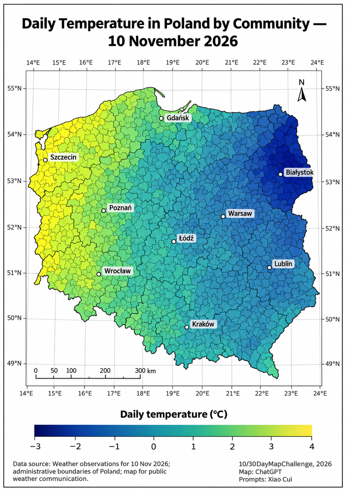
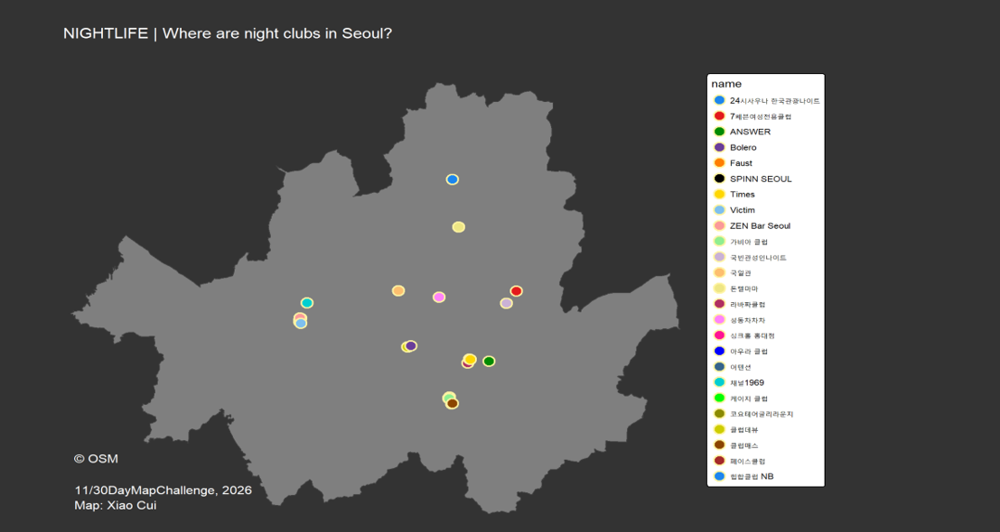
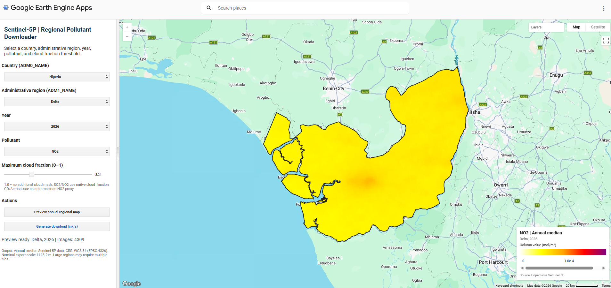
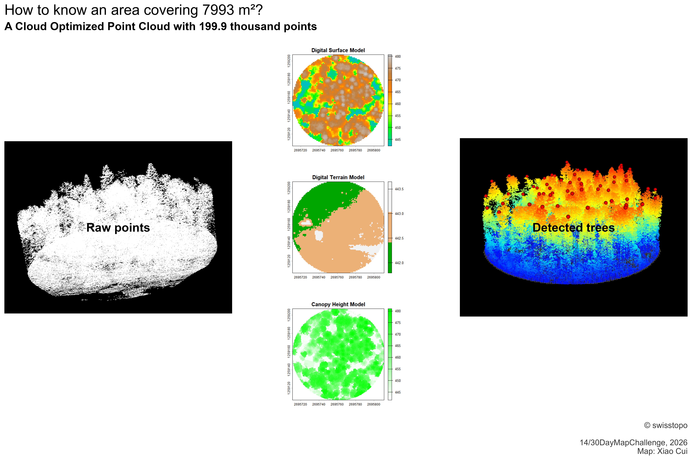
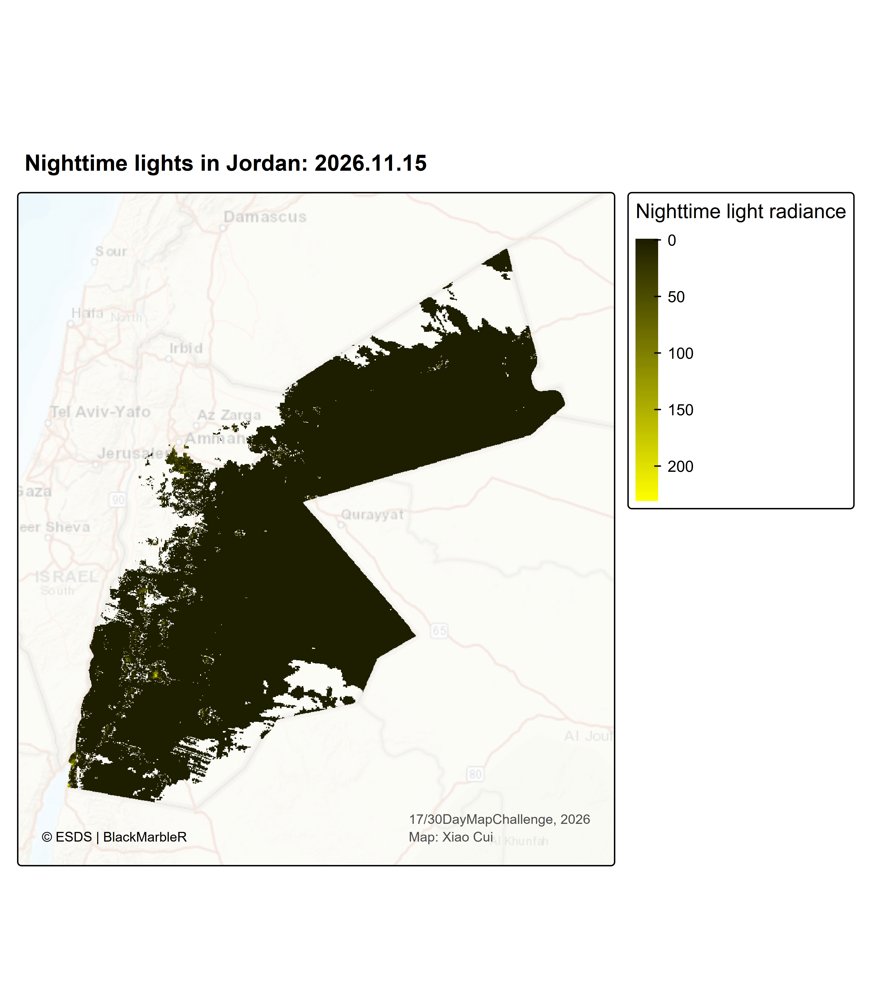
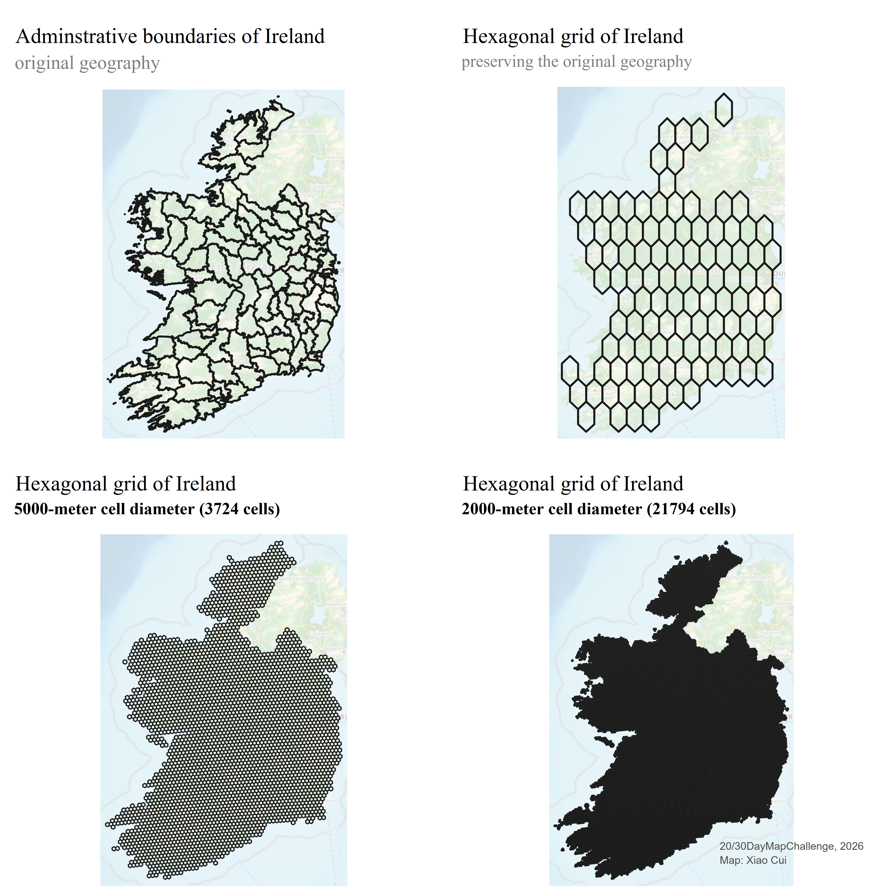
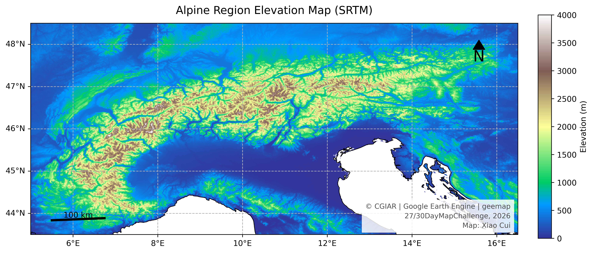

:::: {layout="[ 15, 85 ]"}

::: {#first-column}

:::

::: {#second-column}
[**About me:** This is my first time to attend [Map30DayChallenge](https://30daymapchallenge.com/). As a beginner in GIScience, I usually use R and other open-source tools for mapping. Benifited from such reproducibility, I would like to share most of my workflows on this page. Happy mapping! 😉]{style="color: chocolate;"}
:::

::::

**Availability**: 

::: {.list-table}
- - **Map & code & [data](https://github.com/666Xiao666/30DayMapChallenge2026_XC/tree/main/data):**
  - [Day 1](#points), [Day 2](#lines), [Day 3](#polygons), [Day 5](#senses-sight)
  - [Day 6](#vintage), [Day 7](#minute-map), [Day 8](#utopia), [Day 9](#urban-rural)
  - [Day 12](#power), [Day 15](#inside-out)
  - [Day 16](#collaborative-map), [Day 18](#null), [Day 19](#senses-smell)
  - [Day 21](#openstreetmap), [Day 22](#projections), [Day 24](#network), [Day 25](#is-this-a-map)
  - [Day 26](#water), [Day 27](#new-tool) [(in Python)]{.smallcaps}, [Day 28](#senses-feeling), Day 29.

- - **Map & schematic code:**
  - [Day 4](#clusters), [Day 11](#senses-sound), [Day 17](#light--dark), [Day 20](#hexagons), [Day 23](#senses-taste).

- - **Map without data and/or code:**
  - [Day 10](#prompting-only), [Day 13](#interactions) [(primary GEE code is available)]{.smallcaps}, [Day 14](#borgesian-map), Day 30.
:::

**Note**: Some maps in this html looks occupied, but everything would be fine if they were exported by [`tmap_save`](https://r-tmap.github.io/tmap/reference/tmap_save.html). The instructions of each map are from my [LinkedIn](https://www.linkedin.com/in/xiaocui0312/) posts.

**Now let's start!**

```{r pre}
#| code-summary: "Load packages"
#| code-fold: true
#| code-line-numbers: false
library(sf)
library(terra)
library(dplyr)
library(mapview)
library(tmap)
library(ggplot2)
library(geogrid)
library(maptiles)
library(raster)
library(tmap.networks)
library(sfnetworks)
library(tidyr)
library(tmaptools)
library(tmap.cartogram)
library(tidyverse)
library(rnaturalearth)
library(geodata)
library(gstat)
```

# Points

For the topic "point", I used a proportional symbol map to present a theme / place that I am not familiar with: doctors per province in the Netherlands. 🧐 

```{r day1pre}
#| code-summary: "Load data"
#| code-fold: true
#| code-line-numbers: false
doctors_sf <- base::readRDS("data/doctors_sf.rds")
```

```{r day1mapping}
#| code-summary: "Mapping"
#| code-fold: true
#| code-line-numbers: false
tmap_mode("plot")

tm_basemap("OpenStreetMap") +
  tm_title("Number of doctors in the Netherlands \nper province (NUTS2 region) in 2017", fontfamily = "serif")+
  tm_shape(doctors_sf) +
  tm_polygons(
    fill = NA,
    col = "grey60",
    lwd = 1,
    fill_alpha = 0.5
  ) +
  tm_symbols(
    size = "Doctors",
    shape =19,
    fill = "#008B8B",
    col = "black",
    lwd = 1,
    size.scale = tm_scale(values.scale = 3),
    fill.legend = tm_legend(position = c("right", "center"))
  )  +
  tm_compass(
    type = "arrow",
    position = c("left", "top")
  ) +
  tm_scalebar(
    position = c("left", "bottom")
  ) +
  tm_credits(
    "© Statistics Netherlands (CBS)",size = 0.5,
    position = c("left", "bottom"), bg = TRUE
  )+
  tm_credits(
    "\n1/30DayMapChallenge, 2026",size = 0.6,color = "grey30",
    position = c("left", "bottom"), bg = TRUE
  ) + 
  tm_credits(
    "Map: Xiao Cui",color = "grey30",size = 0.6,
    position = c("left", "bottom"), bg = TRUE
  ) +tm_options(component.autoscale = FALSE)
```

# Lines

I am a bit off the topic "lines" by mapping a sole line, the 100th Meridian West, which marks differences between aridity and humidity in the United States. Does the map today indicate that this climatic boundary shift a bit in the recent year(s)? 🫣

```{r day2pre, message = FALSE, results = "hide"}
#| code-summary: "Load data"
#| code-fold: true
#| code-line-numbers: false
grid_us_sf <- sf::st_read("data/ne_110m_graticules_10.shp")
line_100W_sf <- grid_us_sf |>
  dplyr::filter(display == "100 W")
ppt_2025_rs <- terra::rast("data/prism_ppt_us_30s_2025.tif")
```

```{r day2mapping}
#| code-summary: "Mapping"
#| code-fold: true
#| code-line-numbers: false
tmap_mode("plot")

# 1. Define precipitation intervals
my_breaks <- c(
  0, 200, 400, 600, 800,
  1000, 1500, 2000, 3000, Inf
)

# 2. Define legend labels
my_labels <- c(
  "0–200",
  "200–400",
  "400–600",
  "600–800",
  "800–1000",
  "1000–1500",
  "1500–2000",
  "2000–3000",
  "> 3000"
)

# 3. Define colors
my_cols <- hcl.colors(
  length(my_breaks) - 1,
  palette = "Spectral",
  rev = FALSE
)

# 4. Create map
map_ppt <-
  tmap::tm_shape(ppt_2025_rs) +
  tm_title("What does 'The 100th meridian' mean for the U.S.?", fontfamily = "serif") +
  tmap::tm_raster(
    col.scale = tmap::tm_scale_intervals(
      style = "fixed",
      breaks = my_breaks,
      values = my_cols,
      labels = my_labels,
      interval.closure = "left"
    ),
    col.legend = tmap::tm_legend(
      title = "Total annual\nprecipitation (in.),\n2025",
      title.size = 0.7,
      text.size = 0.7,
      bg.color = "white",
      bg.alpha = 0.6,
      position = tmap::tm_pos_in("left", "bottom"),
      frame = TRUE
    )
  ) +
  tmap::tm_graticules(
    labels.size = 0.7
  ) +
  tmap::tm_compass(
    position = tmap::tm_pos_in("right", "top")
  ) +
  tmap::tm_shape(line_100W_sf) +
  tmap::tm_lines(
    lwd = 6,
    col = "black"
  ) +

  # Manually add the 100th meridian legend
  tmap::tm_add_legend(
    type = "lines",
    labels = "100th meridian",
    col = "black",
    lwd = 6,
    title = "",
    title.size = 1,
    text.size = 1,
    bg.color = "white",
    bg.alpha = 0.7,
    position = tmap::tm_pos_in("right", "bottom"),
    frame = TRUE
  ) +tm_credits(
    "© NACSE",size = 0.7,
    position = c("left", "bottom"), bg = TRUE
  )+
  tm_credits(
    "\n2/30DayMapChallenge, 2026",size = 0.7,color = "grey30",
    position = c("right", "bottom"), bg = TRUE
  ) + 
  tm_credits(
    "Map: Xiao Cui",color = "grey30",size = 0.7,
    position = c("right", "bottom"), bg = TRUE
  )+

  tmap::tm_layout(
    scale = 1.0
  )

# Display
map_ppt
```

# Polygons

For today's topic "polygons", this map say we can present two polygons by using one polygon and an appropriate base map (surprisingly or not!). 👌
Cape Rodney-Okakari Point Marine Reserve, a popular torism destination in New Zealand, includes a large area of surrounding land. The remaining part of Goat Island then "serves" as the interior ring of the marine reserve. 💍⛵ 

```{r day3pre, message = FALSE}
#| code-summary: "Load data"
#| code-fold: true
#| code-line-numbers: false
cape_sf <- sf::st_read("data/protected-areas.gpkg") |>
  dplyr::filter(name == "Cape Rodney-Okakari Point Marine Reserve")
```

```{r, echo=FALSE}
library(maptiles)
Sys.setenv(STADIA_MAPS = "765ffa8b-5075-4148-8a6d-3f1fd7858c52")
```

```{r day3mapping}
#| code-summary: "Mapping"
#| code-fold: true
#| code-line-numbers: false
tmap_mode("plot")

tm_basemap("Stadia.StamenWatercolor") +
  tm_title("Cape Rodney-Okakari Point Marine Reserve and its interior ring", fontfamily = "serif") +
  tm_shape(cape_sf) +
  tm_polygons(
    fill = NA,
    col = "grey70",
    lwd = 1,
    fill_alpha = 0.5
  ) +
  tm_borders(alpha = 0.2) +
  tmap::tm_graticules(
    labels.size = 0.5, crs = 27200
  ) +
  tm_text(text = "Cape Rodney-Okakari \nPoint Marine Reserve", size = 1, col = "grey20", xmod = 1.2, ymod = 2.2) +tm_credits(
    "© LINZ",size = 0.7,
    position = c("left", "bottom"), bg = TRUE
  )+
  tm_credits(
    "\n3/30DayMapChallenge, 2026",size = 0.7,color = "grey30",
    position = c("left", "bottom"), bg = TRUE
  ) + 
  tm_credits(
    "Map: Xiao Cui",color = "grey30",size = 0.7,
    position = c("left", "bottom"), bg = TRUE
  )
```

# Clusters

"Clusters", today's topic, is my start for spatial analysis, so it can be a bit bashful for me to map something about it (can anyone get this point?). 😶‍🌫️
I used Spatio-Temporal Density-Based Spatial Clustering of Applications with Noise (ST-DBSCAN) to distingush "stops" and "moves" for my one-day GPS trajectories (10-second sampling). For each stop, points were rendered as a convex hull to show my activity places.  🏠🏢🍔

```{r, day4mapping, eval = FALSE}
#| code-summary: "Mapping"
#| code-fold: true
#| code-line-numbers: false
ggplot() +
  geom_point() +
  geom_polygon(data = hull_data, aes(X_lv95, Y_lv95, fill = clust), alpha = 0.7) +
  scale_fill_manual(values = MetBrewer::met.brewer("Homer1", 8)) +
  geom_path(data = subset_df_mvt, aes(X_lv95, Y_lv95),color="grey50")  +
  labs(x = "X", y = "Y", fill = "Detected stops",
    title = "ST-DBSCAN stop identification",
    subtitle = "\nSpatial Radius = 100 m, Temporal Radius = 120 s, Minimum Points = 10",
    caption = c("\n4/30DayMapChallenge, 2026", "\nData: Xiao Cui\nMap: Xiao Cui"
  )) +
  theme(plot.title = element_text(family = "serif", face = "bold", size = 20),
        plot.subtitle = element_text(family = "mono", size = 15),
        plot.caption = element_text(size = 10, color = "grey20",hjust = c(0, 1)))
```

{#fig-diagram fig-alt="Day 4" width=80%}

# Senses: Sight

For today's topic "senses: sight", I intended to map something simple but memorable.  ✈️
Many years ago (before the COVID time), when I traveled to Europe for the first time, Montmartre was not the first destination but was the first spot that I considered stunning. I can't remember what exactly attracted me: surrounding landmarks, night scape, or the tavern where I used the restroom? Anyhow, a pleasant feeling embedded in my mind till today. 👻
Thanks to today's map, I went back to my first-time European travel once more. 🤗

```{r day5pre, message = FALSE, results = "hide"}
#| code-summary: "Load data"
#| code-fold: true
#| code-line-numbers: false
point_montmartre_df <- data.frame(
  id = 1,
  lon = 2.343121,
  lat = 48.886452
)

point_montmartre_sf  <- sf::st_as_sf(
  point_montmartre_df,
  coords = c("lon", "lat"),
  crs = 4326
)

bg_tiles <- maptiles::get_tiles(x = point_montmartre_sf, provider = "Esri.WorldImagery", zoom = 19)
```

```{r day5mapping}
#| code-summary: "Mapping"
#| code-fold: true
#| code-line-numbers: false
tm_shape(bg_tiles) +
    tm_rgb(options = opt_tm_rgb(interpolate = FALSE, saturation = 2)) +
tm_title("Snapshot: Montmartre, Paris", fontfamily = "serif", fontface = "bold") +
  tm_graticules(lines = F) +tm_credits(
    "© Esri.WorldImagery",size = 0.8,color = "grey10",
    position = c("right", "bottom"), bg = TRUE
  )+
  tm_credits(
    "\n5/30DayMapChallenge, 2026",size = 0.6,color = "grey30",
    position = c("right", "bottom"), bg = TRUE
  ) + 
  tm_credits(
    "Map: Xiao Cui",color = "grey30",size = 0.6,
    position = c("right", "bottom"), bg = TRUE
  ) +

  tmap::tm_layout(
    scale = 1.1
  )
```

# Vintage

Today's topic "Vintage" is quite challenging, as it's a typical knowledge gap for me. The final map took me about 20 minutes, but I spent much time on conception.📔 
With today's Open Street Map (OSM) data, I imitated a stamp-style Ferraris map (map of the Austrian Netherlands) to present the old city of Ghent, which had been mapped by Joseph de Ferraris during his era. 🗺️🫡

```{r day6pre}
#| code-summary: "Load data"
#| code-fold: true
#| code-line-numbers: false
ghent_buildings <- base::readRDS("data/ghent_buildings.rds")
ghent_buildings_multi <- base::readRDS("data/ghent_buildings_multi.rds")
```

```{r day6mapping}
#| code-summary: "Mapping"
#| code-fold: true
#| code-line-numbers: false
tmap_mode("plot")

tm_shape(ghent_buildings_multi) +
  tm_polygons(fill = "coral4") +
  tm_shape(ghent_buildings) +
  tm_polygons(
    fill = "coral1") +
    tmap::tm_grid(labels.show = FALSE
    ) +
   tm_layout(
    bg.color = "#f4f1ea",          # Cream/off-white stamp paper background
    outer.bg.color = "#d9d2c9",    # Darker background outside the stamp
    frame = TRUE,                  # Turn on the map frame
    frame.lwd = 2,                 # Thick frame border
    frame.color = "#333333",       # Dark charcoal border color
    frame.double_line = TRUE,
    scale = 1.1
  ) +
  tm_title("Imitated Ferraris map: the old city centre of Ghent, Belgium",fontface = "bold",fontfamily = "serif",size = 1.2)+
  tm_title("6/30DayMapChallenge, 2026\nMap: Xiao Cui", size = 0.8, color = "grey40",fontfamily = "serif") +
  tm_credits(
    "© OSM",size = 0.5,color = "grey10",
    position = c("right", "bottom"), bg = FALSE,fontfamily = "serif"
  ) 
```

# 10 minute map

With around 9 minutes, I finished today's theme "10-minute map". With the "World" data from the tmap package (and my semi-prepared code a few days ago 😏), the final map looks qualified, doesn't it? ✔️
The imperfect part is also obvious: the legend should have been at the right of the layout, instead of the bottom like now. 🫠

```{r day7pre}
#| code-summary: "Load data"
#| code-fold: true
#| code-line-numbers: false
South_America <- World[World$continent == "South America", ]
South_America <- South_America |>
  dplyr::rename(IncomeGroup = income_grp)
```

```{r day7mapping}
#| code-summary: "Mapping"
#| code-fold: true
#| code-line-numbers: false
tmap_mode("plot")

tm_shape(South_America) +
tm_title("Income Group, South America, 2024", fontfamily = "serif", fontface = "bold") +
  tm_polygons(fill = "IncomeGroup", fill.scale = tm_scale_categorical(values = "-brewer.yl_or_br"), fill_alpha = 0.9) +
  tm_text("name", size = 0.8, options = opt_tm_text(remove_overlap = FALSE))  +tm_credits(
    "© NED",size = 0.8,color = "grey10",
    position = c("right", "bottom"), bg = TRUE
  )+
  tm_credits(
    "7/30DayMapChallenge, 2026",size = 0.6,color = "grey30",
    position = c("right", "bottom"), bg = TRUE
  ) + 
  tm_credits(
    "Map: Xiao Cui",color = "grey30",size = 0.6,
    position = c("right", "bottom"), bg = TRUE
  ) +

  tmap::tm_layout(
    bg.color = "lightblue",scale = 1.1
  ) +tm_options(component.autoscale = FALSE)
```

# Utopia

For today's topic, "Utopia", I mapped the current world, showing lands, rivers, and oceans. I know an ideal society is quite challenging to create, but people's beautiful qualities (kindness, wisdom, etc.) can make this world much better to achieve that goal. 👁️

```{r day8pre}
#| code-summary: "Load data"
#| code-fold: true
#| code-line-numbers: false
world_union <- sf::st_union(World)
```

```{r day8mapping}
#| code-summary: "mapping"
#| code-fold: true
#| code-line-numbers: false
tmap_mode("plot")
tm_shape(world_union) +
    tm_polygons(fill = "whitesmoke") +
  tm_shape(World_rivers) +
    tm_lines(lwd = "strokelwd", col = "lightblue",
             lwd.scale = tm_scale_asis(values.scale = 0.2))  +
tm_crs("+proj=eck4")  + 
tm_layout(earth_boundary = TRUE,
          earth_boundary.lwd = 2,
          legend.show = FALSE,     # option to disable all legends
          frame = FALSE,
          space.color = "white", bg.color = "dodgerblue")  +tm_credits(
    "© tmap",size = 0.8,color = "grey10",
    position = c("right", "bottom"), bg = TRUE) +
  tm_title("A Utopia could be a real world without prejudice.", fontfamily = "serif", fontface = "bold") +
  tm_title("\n8/30DayMapChallenge, 2026\nMap: Xiao Cui", size = 0.8, color = "grey40",fontfamily = "serif") +
  tmap::tm_layout(
    scale = 1.1
  )
```

# Urban-rural

"Urban-rural" relationships seem to go against in most cases, but this binary view ignores complicated dynamic patterns of human settlement. 🥸 
Even for large cities or megacities, an overall high population density doesn't mean everywhere can be defined as "urban" in these cities. Today's human settlement map (Vienna, Austria) can show such complexity clearly. 👀

```{r day9pre}
#| code-summary: "Load data"
#| code-fold: true
#| code-line-numbers: false
# load raw data
GHS_SMOD_vienna <- terra::rast("data/GHS-SMOD-Vienna-2025-2030.tif")
# Convert 0 to NA
GHS_SMOD_vienna_clean <- terra::ifel(
  GHS_SMOD_vienna == 0,
  NA,
  GHS_SMOD_vienna
)
# Trim the raster extent to valid cells
GHS_SMOD_vienna_clean <- terra::trim(
  GHS_SMOD_vienna_clean
)
# Define categories
smod_classes <- data.frame(
  ID = c(11, 12, 13, 21, 30),
  Class = c(
    "Very low density rural",
    "Low density rural",
    "Rural cluster",
    "Suburban",
    "Urban centre"
  )
)
# Assign categories
GHS_SMOD_vienna_clean <- terra::as.factor(
  GHS_SMOD_vienna_clean
)
levels(GHS_SMOD_vienna_clean) <- smod_classes

# Extract the current extent (bounding box)
e <- ext(GHS_SMOD_vienna_clean)
# Expand by a scale factor (e.g., multiply the width and height by 1.1)
e_expanded <- e * 1.1
# Convert to a SpatVector polygon, then to an sf object
sf_extent <- st_as_sf(vect(e_expanded, crs = "EPSG:3416"))
```

```{r day9mapping}
#| code-summary: "Mapping"
#| code-fold: true
#| code-line-numbers: false
tmap_mode("plot")

tm_shape(GHS_SMOD_vienna_clean, bbox = sf_extent) + tm_title("Is everywhere urban for Vienna?", fontfamily = "serif", fontface = "bold") + 
  tm_title("\nAn insight from Global Human Settlement Layer (GHSL) Settlement Model (SMOD), 2025-2030", fontfamily = "serif", size = 0.8) + tm_basemap("OpenStreetMap.DE") +
  tm_raster(col_alpha = 0.5,palette = "Set1",
    col.legend = tm_legend("GHS-SMOD classification",
      show = TRUE
    )
  ) +
  tm_layout(
    frame = TRUE,
    legend.outside = TRUE
  ) +
  tm_grid(lines = T) +
tm_crs(3416) +tm_credits(
    "© GAUL | GHSL | GEE | OSM",size = 0.5,
    position = c("right", "bottom"), bg = TRUE
  )+
  tm_credits(
    "9/30DayMapChallenge, 2026",size = 0.5,color = "grey30",
    position = c("right", "bottom"), bg = TRUE
  ) + 
  tm_credits(
    "Map: Xiao Cui",color = "grey30",size = 0.5,
    position = c("right", "bottom"), bg = TRUE
  ) + tm_options(component.autoscale = FALSE)
```

# Prompting only

I followed today's topic "Prompting only" seriously. After inputting prompts and waiting for around 5 minutes, I got this pragmatic weather forecasting map. It is getting cold and please remember to put on more clothes. 🍃🌨️🧥

> **Create image** Please create a map for me to show one-day daily temperature at the community level of Poland. Please generate the title according to the date of observation. There is no restriction for the color scheme in the legend, but it should be color-blind- friendly.
Consider the purpose of this map is for weather forecasting torwards the public, please choose the style for the coordinate system, north narrow, and scale bar accordingly. Please mark the data source at the left bottom of the map. Finally, please add the following three-line credits on the right bottom of the map in dark grey: "10/30DayMapChallenge, 2026", "Map: ChatGPT `your version`", "Prompts: Xiao Cui".

{width=80%}

# Senses: Sound

For today's topic "Senses: Sound", I used a dark background to show night context of this map: night clubs (or bars or live houses) can be silent during daytime, but it comes to a different story when it gets darker. 🌃 
Moreover, can you find one (or two) tricky setting(s) for this map? 🙊

```{r, day11mapping, eval = FALSE}
#| code-summary: "Mapping"
#| code-fold: true
#| code-line-numbers: false
tmap_mode("plot")

tm_shape(bbox) +
  tm_polygons(
    fill = "grey50",
    col = NA
  ) +
  tm_shape(livehouses) +
  tm_symbols(
    fill = "yellow",
    size = 1,
    col = "#FFF4A3",
    lwd = 2, fill.legend = tm_legend("Night clubs", show = TRUE)
  ) +
  tm_layout(
    bg.color = "grey20",
    outer.bg.color = "grey20",
    frame = FALSE
  ) +
  tm_title(
    "Where are night clubs in Seoul?",
    color = "#FFFFFF",
    position = tm_pos_out("center", "top")
  ) +tm_options(component.autoscale = TRUE) +tm_credits(
    "© OSM",size = 0.8,color = "white",
    position = c("left", "bottom"), bg = FALSE
  )+
  tm_credits(
    "\n11/30DayMapChallenge, 2026",size = 0.6,color = "white",
    position = c("left", "bottom"), bg = FALSE
  ) + 
  tm_credits(
    "Map: Xiao Cui",color = "white",size = 0.6,
    position = c("left", "bottom"), bg = FALSE
  )
```

{width=80%}

# Power

"Power", today's topic, is a bit difficult to define or depict. If we limited this topic at a large-scale scope, I would say education can be a power for generations. With that idea, I mapped the schools in Singapore and emphasize their region-level distribution. 🎒🏫

```{r day12pre}
#| code-summary: "Load data"
#| code-fold: true
#| code-line-numbers: false
# load data
boundary_sg_sf <- readRDS("data/boundary_sg_sf.rds")
school_sg_sf <- readRDS("data/school_sg_sf.rds")
# bbox for inset map: CR
bb_centre <- tmaptools::bb(boundary_sg_sf[boundary_sg_sf$REGION_C == "CR",], ext = 1.0)
# inset plot
gg1 <- ggplot(boundary_sg_sf, aes(REGION_C, n_schools)) + 
  geom_col() +
  scale_y_continuous(labels = scales::comma) +
  labs(x = NULL, y = "Count") +
  theme_minimal() + labs(title = "Number of schools\nper region") +
  theme(plot.title = element_text(size = 8),axis.title = element_text(size = 7), axis.text = element_text(size = 5))
```

```{r day12mapping}
#| code-summary: "Mapping"
#| code-fold: true
#| code-line-numbers: false
tmap_mode("plot")
tm_shape(boundary_sg_sf) +
  tm_polygons(fill = "grey90", fill_alpha = 0.5, col = "blue1")+ tm_basemap("Esri.WorldStreetMap") +
  tm_shape(school_sg_sf) +
tm_title("Schools of Singapore", fontfamily = "serif", fontface = "bold") +
  tm_title("Land Transport Authority (LTA), 2024", fontfamily = "serif", size = 1) +
  tm_polygons(fill = "black") + 
  tm_add_legend(
    type = "polygons",
    labels = "Schools",
    fill = "black",
    position = c("left", "top")
  ) + tm_scalebar(position = c("left", "top"), bg =FALSE) +
  tm_credits(
    "© data.gov.sg",size = 0.8,color = "grey10",
    position = c("right", "bottom"), bg = TRUE
  )+
  tm_credits(
    "\n12/30DayMapChallenge, 2026",size = 0.6,color = "grey30",
    position = c("right", "bottom"), bg = TRUE
  ) + 
  tm_credits(
    "Map: Xiao Cui",color = "grey30",size = 0.6,
    position = c("right", "bottom"), bg = TRUE
  ) +tm_options(component.autoscale = FALSE) + tm_title("CENTRAL REGION (CR)", group_id = 1, size = 0.7, bg = TRUE) + tm_inset(bb_centre, group_id = 1, height = 10, width = 10, main_frame = TRUE, main_frame.color = "red")  +
  tm_components(1, position = c("right", "top")) +
  tm_inset(gg1, position = c("left", "bottom")) 
```

# Interactions

For today's topic "Interactions", I developed a simple Google Earth Engine (GEE) application to map regional annual SO2/NO2/CO/Aerosol, using Sentinel-5P data. 🛰️
The screenshot below shows a use case. 🧑‍💻👩‍💻

The link of the interactive application (it can be a bit slow to show the map 🙈): <https://ee-xiaocui.projects.earthengine.app/view/ndwiui30daymcxcui>

The link of the primary code used in the application: <https://code.earthengine.google.com/44a6e215b35db2cda0a30b683ef59134>

{width=80%}

# Borgesian map

As a beginner in LiDAR, I think point cloud data is quite suitable for today's topic "Borgesian map": what we can capture from mass data is still in our boundary.  
🔍 In today's map, I showed a standard workflow to detect trees from point cloud data. 25.01 points/m² is a precise density indeed, but what we aim to learn from such data depends on different contexts and purposes.

The data can be downloaded at: <https://cms.geo.admin.ch/Topo/swisssurface3d/swissSURFACE3D_example.zip>

More information about swissSURFACE3D: <https://www.swisstopo.admin.ch/en/height-model-swisssurface3d>

{width=80%}

# Inside out

For today's topic "Inside out", a real nodus is to select "inside". An interesting view can be: how do we learn about "the outside" with our "inner knowledge"? 👓 
Using an inverted Cylindrical projection, I mapped glaciated areas over the world. The map asks a geographic question: would our perception about the world be different if we found and named "the south magnetic pole" first? 🔖
Although Arctic and Antarctica are still at the two poles, the final map reveals another "inside-out" pattern: some of glaciated areas are neither in the arctic circle nor in the antarctica circle. 🧩

```{r day15pre}
#| code-summary: "Load data"
#| code-fold: true
#| code-line-numbers: false
# Load world map data
world <- ne_countries(scale = "medium", returnclass = "sf")
# Define an inverted Cylindrical Equal Area (Peters) projection using +axis=wsu
inverted_crs <- "+proj=cea +lat_ts=45 +lon_0=0 +x_0=0 +y_0=0 +datum=WGS84 +units=m +no_defs +axis=wsu"
world_inverted <- st_transform(world, crs = inverted_crs)

# Load glaciers data
glaciers <- ne_download(
  scale = 50,
  type = "glaciated_areas",
  category = "physical",
  returnclass = "sf"
)
glaciers_inverted <- st_transform(glaciers, crs = inverted_crs)
# Add a categorical column
glaciers_inverted$legend_label <- "Glaciated Areas"
```

```{r day15mapping}
#| code-summary: "Mapping"
#| code-fold: true
#| code-line-numbers: false
ggplot() + geom_sf(data = world_inverted, fill = "grey95", color = "white", linewidth = 0.2) +
  geom_sf(
    data = glaciers_inverted,
    aes(fill = legend_label),
    color = "steelblue",
    linewidth = 0.2,
    show.legend = TRUE
  ) +
  scale_fill_manual(
    name = NULL,
    values = c("Glaciated Areas" = "steelblue"),
    breaks = "Glaciated Areas",
    drop = FALSE
  ) +
  guides(
    fill = guide_legend(
      override.aes = list(
        color = "steelblue",
        linewidth = 0.2
      )
    )
  ) +
  theme_minimal() +
  theme(legend.text = element_text(family = "serif"),
    legend.position = "right"
  ) + coord_sf(
    datum = st_crs(inverted_crs)) +
  scale_x_continuous(labels = function(x) format(x, scientific = FALSE)) +
  scale_y_continuous(labels = function(x) format(x, scientific = FALSE)) +
  labs(x = "X", y = "Y", 
    title = "Antarctica: named from 'Anti Arctic'",
    subtitle = "But where is Arctic?",
    caption = c("\n15/30DayMapChallenge, 2026", "\n© rnaturalearth\nMap: Xiao Cui"
  )) +
  theme(plot.title = element_text(family = "serif", face = "bold", size = 20),
        plot.subtitle = element_text(family = "serif", size = 18),
        plot.caption = element_text(family = "serif", size = 10, color = "grey20",hjust = c(0, 1)))
```

# Collaborative map

Today's topic "collaborative map" reminded me of the time when I was a beginner in cartography. When I worked on the assignments at that time, I was like: 😫.
With a lengthy learning curve, I become an advanced beginner nowadays! 🤣 Using data from the study area in previous coursework, I collaborated with me of the past to finish today's theme. 🎁 

```{r day16pre}
#| code-summary: "Load data"
#| code-fold: true
#| code-line-numbers: false
boroughs <- base::readRDS("data/boroughs.rds")
```

```{r day16mapping}
#| code-summary: "Mapping"
#| code-fold: true
#| code-line-numbers: false
tmap_mode("plot")

# Map 1: Custom legend
t1 <- tm_shape(boroughs) + tm_title("Population in London Boroughs (2025)") +
  tm_title("A collaborative map with me of the past", size = 0.9, color = "gold4") +
  tm_polygons(
    fill = "pop_per_km2",
    fill.scale = tm_scale_intervals(
      values = "brewer.yl_gn"
    ),
    fill.legend = tm_legend(
      title = "Population per km2",
      na.show = FALSE
    )
  ) +
  tm_credits(
    "© CityPopulation.DE & TFL London Boroughs",
    size = 0.5,
    color = "grey10",
    position = c("left", "bottom"),
    bg = TRUE
  ) +
  tm_credits(
    "\n16/30DayMapChallenge, 2026",
    size = 0.5,
    color = "grey30",
    position = c("right", "bottom"),
    bg = TRUE
  ) +
  tm_credits(
    "Map: Xiao Cui (2024 & current)",
    color = "grey30",
    size = 0.5,
    position = c("right", "bottom"),
    bg = TRUE
  )  + tm_options(component.autoscale = FALSE)

# Map 2: Hide legend completely
t2 <- tm_shape(boroughs) +
  tm_polygons(
    fill = "pop_per_km2",
    fill.scale = tm_scale_intervals(
      values = "brewer.yl_gn"
    ),
    fill.legend = tm_legend_hide()
  ) +
  tm_facets_wrap(
    "borough",
    nrow = 4,
    ncol = 8
  )  + tm_options(component.autoscale = FALSE)

# Combine maps
tmap_arrange(t1, t2, ncol = 1)
```

# Light & dark

Nighttime light is very suitable for today's topic "Light & dark", as it contains these two elements at the same time. 💡Thus, I mapped one-day nighttime light of Jordan, using VNP46A3 data. The contrast in this map reminds us of dynamics between light and dark in the real world. 🌞🌚

```{r, day17mapping, eval = FALSE}
#| code-summary: "Mapping"
#| code-fold: true
#| code-line-numbers: false
tmap_mode("plot")

tm_shape(r) + tm_basemap("Esri.WorldStreetMap", alpha = 0.2) +
  tm_raster(
    col = names(r)[1],
    col.scale = tm_scale_continuous(
      values = c("black", "yellow"),
      midpoint = 100,
      value.na = "transparent"
    ),
    col.legend = tmap::tm_legend(
            title = "Nighttime light radiance",na.show = FALSE)
  ) + 
  tm_title(
    text = "Nighttime lights in Jordan: 2026.11.15",
    size = 1,
    fontface = "bold"
  ) +
  tm_layout(scale = 1, 
    frame = TRUE,
    inner.margins = c(0.1, 0.1, 0.1, 0.1),
    bg.color = "white",
    outer.bg.color = "white"
  )  +tm_credits(
    "© ESDS | BlackMarbleR",size = 0.6,
    position = c("left", "bottom"), bg = FALSE
  )+
  tm_credits(
    "\n17/30DayMapChallenge, 2026",size = 0.6,color = "grey30",
    position = c("right", "bottom"), bg = FALSE
  ) + 
  tm_credits(
    "Map: Xiao Cui",color = "grey30",size = 0.6,
    position = c("right", "bottom"), bg = FALSE) + tm_options(component.autoscale = FALSE)
```

{width=80%}

# NULL

I planned to skip today's topic when I found it is "null" (just kidding 😂). If it meant "zero", an interesting symbol in geography would be "sea level datum", which serves as the official zero-meter vertical datum and altimetric reference. I mapped a single station of the National Tide Gauge Network (Italy), but what behind it (or every datum) is always continuous observations over many years with great efforts. ⏳

```{r day18pre}
#| code-summary: "Load data"
#| code-fold: true
#| code-line-numbers: false
roi_sf <- gadm(country = "ITA", level=1, path = tempdir())

# Convert DMS to decimal degrees
lat <- 44 + 24/60 + 36.46/3600
lon <- 8 + 55/60 + 31.86/3600

# Create sf point
point_sf <- data.frame(
  lon = lon,
  lat = lat
) |>
  st_as_sf(
    coords = c("lon", "lat"),
    crs = 4326
  )
point_sf <- point_sf |>
  dplyr::mutate(name = "GENOVA")
```

```{r, day18mapping}
#| code-summary: "Mapping"
#| code-fold: true
#| code-line-numbers: false
tmap_mode("plot")

tm_basemap("Esri.WorldTerrain") +
  tm_title("Where we define vertical '0.00 m'\nin Italy?", fontfamily = "serif") +
  tm_shape(roi_sf) +
  tm_fill(
    fill = "grey60",
    fill_alpha = 0.5
  ) + 
  tm_borders(col = "grey60", lwd = 0.5, lty = "dashed") + 
  tm_shape(point_sf) + tm_symbols(shape = 23, fill = "blue")+
  tmap::tm_graticules(
    labels.size = 0.5, crs = 6875
  ) +
  tm_text(text = "The Port of Genova", size = 0.8, ymod = 1.2) +tm_credits(
    "© ISPRA",size = 0.9,
    position = c("left", "bottom"), bg = FALSE
  )+
  tm_credits(
    "\n18/30DayMapChallenge, 2026",size = 0.7,color = "grey30",
    position = c("right", "bottom"), bg = FALSE
  ) + 
  tm_credits(
    "Map: Xiao Cui",color = "grey30",size = 0.7,
    position = c("right", "bottom"), bg = FALSE
  )
```

# Senses: Smell

For today's theme "Senses: Smell", it's a great idea to show flower scent. With the observation data from the Global Biodiversity Information Facility (GBIF), I mapped osmanthus in Hunan, China, for its delicate floral (and yummy) perfume. Anyone likes dessert with osmanthus? 😋

```{r day19pre}
#| code-summary: "Load data"
#| code-fold: true
#| code-line-numbers: false

osmanthus_Hunan_sf <- base::readRDS("data/osmanthus_Hunan_sf.rds")
roi_hunan_sf <- base::readRDS("data/roi_hunan_sf.rds")

icon <- tmap_icons("data/pngwing.png", width = 10, height = 10)
```

```{r, day19mapping}
#| code-summary: "Mapping"
#| code-fold: true
#| code-line-numbers: false
tmap_mode("plot")

tm_basemap("Esri.NatGeoWorldMap", alpha = 0.5) + tm_title("Where can you smell osmanthus in Hunan?", fontfamily = "serif") + 
  tm_shape(roi_hunan_sf) + tm_borders() +
tm_shape(osmanthus_Hunan_sf) +
  tm_symbols(shape = icon) +
  tm_graticules(crs = 4480) + tm_options(component.autoscale = FALSE) +tm_credits(
    "© GBIF",size = 0.9,
    position = c("left", "bottom"), bg = TRUE
  )+
  tm_credits(
    "\n19/30DayMapChallenge, 2026",size = 0.7,color = "grey30",
    position = c("left", "bottom"), bg = TRUE
  ) + 
  tm_credits(
    "Map: Xiao Cui",color = "grey30",size = 0.7,
    position = c("left", "bottom"), bg = TRUE
  ) + tm_scalebar(position = c("right", "bottom"), bg = FALSE)
```

# Hexagons

"Hexagons" are common polygons for fine-grained modeling, but how can we feel the differences between "coarse" and "nuanced" more directly? 🤔
Using 106 municipalities data, I mapped the original administrative boundaries and three hexagonal grids of Ireland under a same scale. Although a 2km-hexagonal grid (right bottom) is not quite fine for current population-level studies, it generates a much larger sample compared with the original administrative boundaries. 🔎

```{r day20mapping, eval = FALSE}
#| code-summary: "Mapping"
#| code-fold: true
#| code-line-numbers: false
tgg1 <- tm_shape(roi_sf_l2) + tm_basemap("OpenTopoMap", alpha = 0.2) + tm_title("Adminstrative boundaries of Ireland", fontfamily = "serif", size = 1) + tm_title("original geography", fontfamily = "serif", color = "grey50", size = 0.9) +
  tm_borders(col = "grey10", lwd = 1.5)  + tm_options(component.autoscale = FALSE) + tm_layout(frame = FALSE)

tgg2 <- tm_shape(roi_hex_sf_l2) + tm_basemap("OpenTopoMap", alpha = 0.2) +tm_title("Hexagonal grid of Ireland", fontfamily = "serif", size = 1) + tm_title("preserving the original geography", fontfamily = "serif", size = 0.8, color = "grey50") +
  tm_borders(col = "grey10", lwd = 1.5) + tm_options(component.autoscale = FALSE) + tm_layout(frame = FALSE)

tgg3 <- tm_shape(clipped_grid_5k)  + tm_title("Hexagonal grid of Ireland", fontfamily = "serif", size = 1) + tm_title("5000-meter cell diameter (3724 cells)", fontfamily = "serif", size = 0.8, fontface = "bold") + tm_basemap("OpenTopoMap", alpha = 0.2) + 
  tm_borders(col = "grey10", lwd = 0.9)  + tm_options(component.autoscale = FALSE) + tm_layout(frame = FALSE)

tgg4 <- tm_shape(clipped_grid_2k) + tm_basemap("OpenTopoMap", alpha = 0.2) +
  tm_borders(col = "grey10", lwd = 0.9) + tm_title("Hexagonal grid of Ireland", fontfamily = "serif", size = 1) + tm_title("2000-meter cell diameter (21794 cells)", fontfamily = "serif", size = 0.8, fontface = "bold") + tm_options(component.autoscale = FALSE) + tm_credits(
    "\n20/30DayMapChallenge, 2026",size = 0.5,color = "grey30",
    position = c("right", "bottom"), bg = FALSE
  ) + 
  tm_credits(
    "Map: Xiao Cui",color = "grey30",size = 0.5,
    position = c("right", "bottom"), bg = FALSE
  ) + tm_layout(frame = FALSE)

tmap_arrange(tgg1, tgg2, tgg3, tgg4, ncol = 2)
```

{#fig-diagram fig-alt="Day 20" width=80%}

# OpenStreetMap

For today's topic "OpenStreetMap", I went back to my comfort zone, mapping green spaces defined by the values in "leisure" or "landuse".🌳Maybe Macao is a nice place for playing golf. 🤨

```{r day21pre, results = "hide"}
#| code-summary: "Load data"
#| code-fold: true
#| code-line-numbers: false
GS_macao <- sf::st_read("data/export_macao.geojson") |>
  filter(st_geometry_type(geometry) %in% c("POLYGON", "MULTIPOLYGON"))

GS_macao <- GS_macao |>
  unite(Type, c(landuse, leisure), sep = " ", remove = FALSE,
    na.rm = TRUE)
```

```{r, day21mapping}
#| code-summary: "Mapping"
#| code-fold: true
#| code-line-numbers: false
tm_shape(GS_macao) + tm_basemap("OpenStreetMap", alpha = 0.3) +
  tm_polygons(
    fill = "Type",
    fill.scale = tm_scale_categorical(values = "matplotlib.yl_gn"),
    col = NA,
    fill.legend = tm_legend(position = tm_pos_out("right", "center"))
  ) + tm_title(
    "Green space in Macao",
    fontfamily = "serif",
    position = tm_pos_out("center", "top")
  ) +tm_options(component.autoscale = TRUE) +tm_credits(
    "© OSM",size = 0.8,color = "grey30",
    position = c("right", "bottom"), bg = FALSE
  )+
  tm_credits(
    "\n21/30DayMapChallenge, 2026",size = 0.6,color = "grey30",
    position = c("left", "bottom"), bg = FALSE
  ) + 
  tm_credits(
    "Map: Xiao Cui",color = "grey30",size = 0.6,
    position = c("left", "bottom"), bg = FALSE
  ) 
```

# Projections

For today's topic "projections", it's difficult for me to pick one up: each projection has their own pros (and also cons).  After a bit of thinking, I chose cartogram, as it's my first time to make a cartogram by myself. 😸
With fancy tmap.cartogram, I was suprised that I was able to show the distortion of that map as well! 😯

```{r day22pre}
#| code-summary: "Load data"
#| code-fold: true
#| code-line-numbers: false
Africa = World[World$continent == "Africa", ]
```

```{r, day22mapping}
#| code-summary: "Mapping"
#| code-fold: true
#| code-line-numbers: false
tm_shape(Africa, crs = "+proj=robin") +
    tm_cartogram(size = "*pop_est", 
                 fill = "well_being",
                 fill.scale = tm_scale_intervals(values = "-hcl.green_orange"),
                 fill.legend = tm_legend("Well being\n(from 0 to 10)")
                 ) +
tm_title("Well being in Africa", fontfamily = "serif", fontface = "bold") +
  tm_title("A contiguous cartogram distorted by population", fontfamily = "serif", color = "grey40", size = 1) +tm_credits(
    "© HPI",size = 0.7,
    position = c("left", "bottom"), bg = TRUE
  )+
  tm_credits(
    "\n22/30DayMapChallenge, 2026",size = 0.7,color = "grey30",
    position = c("left", "bottom"), bg = TRUE
  ) + 
  tm_credits(
    "Map: Xiao Cui",color = "grey30",size = 0.7,
    position = c("left", "bottom"), bg = TRUE
  ) +tm_options(component.autoscale = FALSE)
```

# Senses: Taste

Asia is the largest honey producing region with many top producers (and exporters) in recent years. For today's topic "senses: taste", I mapped honey in Asia using "honey" as the paint. 😼 Maybe it's high time to have a cup of honey water after finishing today's map challenge. 😋

```{r day23mapping, eval = FALSE}
#| code-summary: "Mapping"
#| code-fold: true
#| code-line-numbers: false
tm_shape(honey_fao_sf) + 
  tm_polygons(fill = "grey90",fill_alpha = 0.7)  + tm_title("Honey production in Asia (2023)", fontfamily = "serif",fontface = "bold") +
  tm_symbols(
    size = "Value",
    title = "1000 t",
    size.legend = tm_legend("Honey\n(1000 t)"),
    shape =19,
    fill = "orange",
    col = "black",
    lwd = 1,
    size.scale = tm_scale(values.scale = 3),
    fill.legend = tm_legend(position = c("right", "center"))
  ) + tm_credits(
    "© FAOSTAT",size = 0.7,
    position = c("left", "bottom"), bg = FALSE
  )+
  tm_credits(
    "\n23/30DayMapChallenge, 2026",size = 0.7,color = "grey30",
    position = c("left", "bottom"), bg = FALSE
  ) + 
  tm_credits(
    "Map: Xiao Cui",color = "grey30",size = 0.7,
    position = c("left", "bottom"), bg = FALSE
  ) + 
  tm_logo("data_23rd/honey.png",
          height = 5,position  = c("right", "bottom"))
```

{width=80%}

# Network

What first came to my mind was "road network" for today's theme. Using a subset road data of Hamburg, I mapped the network with its identified cut nodes. 🧐 Definitely, the most difficult part of today's mapping is finding related data and preprocessing them to a network. 🤣

```{r day24pre}
#| code-summary: "Load data"
#| code-fold: true
#| code-line-numbers: false
filtered_hamburg <- base::readRDS("data/filtered_hamburg.rds")
cut_nodes <- base::readRDS("data/cut_nodes.rds")
```

```{r, day24mapping}
#| code-summary: "Mapping"
#| code-fold: true
#| code-line-numbers: false
tm_shape(filtered_hamburg) + tm_title("933 cut nodes in a\n1km-circular road network", fontfamily = "serif",fontface = "bold") + tm_edges(col = "highway", lwd = 1, col_alpha = 0.5) + tm_shape(cut_nodes) + tm_nodes(lwd = 4, col_alpha = 0.5, col = "red") +
  tm_graticules(crs = 4326) + tm_credits(
    "© bbbike",size = 0.9,
    position = c("left", "bottom"), bg = FALSE
  )+
  tm_credits(
    "24/30DayMapChallenge, 2026",size = 0.5,color = "grey30",
    position = c("right", "bottom"), bg = FALSE
  ) + 
  tm_credits(
    "Map: Xiao Cui",color = "grey30",size = 0.5,
    position = c("right", "bottom"), bg = FALSE
  )
```

# Is this a map?

For today's topic "Is this a map?", I chose a typical uncertainty map. After finishing that, I attempted to answer today's question: the reliability of such maps depends on the extent of we make certain of "certain". 🥸 

```{r day25pre}
#| code-summary: "Load data"
#| code-fold: true
#| code-line-numbers: false
# Load sample data and convert to an sf object
data(meuse, package = "sp")
meuse_sf <- st_as_sf(meuse, coords = c("x", "y"), crs = 28992)

# Create a prediction grid (raster) over the bounding box
grid_rast <- rast(ext(meuse_sf), resolution = 40, crs = "EPSG:28992")
grid_pts <- as.points(grid_rast) |> st_as_sf()

# Fit an empirical and theoretical variogram (using log-zinc)
v_emp <- variogram(log(zinc) ~ 1, data = meuse_sf)
v_mod <- fit.variogram(v_emp, model = vgm("Sph"))

# Perform Ordinary Kriging
krig_res <- krige(
  formula = log(zinc) ~ 1,
  locations = meuse_sf,
  newdata = grid_pts,
  model = v_mod
)

# Calculate Kriging Standard Error (Uncertainty)
krig_res$krig_se <- sqrt(krig_res$var1.var)

# Convert back to a SpatRaster for easy plotting/exporting
se_rast <- rasterize(vect(krig_res), grid_rast, field = "krig_se")
```

```{r, day25mapping}
#| code-summary: "Mapping"
#| code-fold: true
#| code-line-numbers: false
tm_shape(se_rast) + tm_title("Uncertainty map of zinc concentrations\nin the Meuse River", fontfamily = "serif", fontface = "bold") + 
  tm_title("Results from Ordinary Kriging", fontfamily = "serif", size = 1.2, color = "grey30") +
  tm_raster(title = "Std. Error\n(log ppm)",col_alpha = 0.5,palette = "magma",
    col.legend = tm_legend(show = TRUE)
  ) +
  tm_layout(
    frame = TRUE,
    legend.outside = TRUE
  ) +
  tm_graticules(n.x = 5, col = "grey90") +tm_credits(
    "© sp",size = 0.8,
    position = c("left", "top"), bg = FALSE
  )+
  tm_credits(
    "\n25/30DayMapChallenge, 2026",size = 0.6,color = "grey30",
    position = c("left", "top"), bg = FALSE
  ) + 
  tm_credits(
    "Map: Xiao Cui",color = "grey30",size = 0.6,
    position = c("left", "top"), bg = FALSE
  ) + tm_options(component.autoscale = FALSE)
```

# Water

For today's topic "water", I selected the Three Parallel Rivers for mapping (note: I refer to rivers' current (Chinese) name). It's noteworthy that the basemap here presents several kinds of languages. These water bodies nurtured many civilizations, but what we know about the processes is still limited.  📘

```{r day26pre, results = "hide"}
#| code-summary: "Load data"
#| code-fold: true
#| code-line-numbers: false
RIVERS <- ne_download(scale = 10, type = 'rivers_lake_centerlines', category = 'physical', returnclass = "sf")
threeParallelRivers_sf <-  RIVERS |>
  dplyr::filter(name == "Nu" | name == "Jinsha" | name == "Lancang")

threeParallelArea_sf <- sf::st_read("data/WDPA_WDOECM_Nov2026_Public_900881.gdb", layer = "WDPA_WDOECM_poly_Nov2026_900881")

threeParallelArea_bb <- tmaptools::bb(threeParallelArea_sf, ext = 1.1)
```

```{r, day26mapping}
#| code-summary: "Mapping"
#| code-fold: true
#| code-line-numbers: false
tmap_mode("plot")

tm_shape(threeParallelRivers_sf) +
  tm_lines(col = "steelblue1", lwd = 5, col_alpha = 0.9) + tm_text(text = "name", fontface = "bold", size = 1.4) + tm_basemap("OpenStreetMap") + tm_shape(threeParallelArea_sf) +
  tm_polygons(fill = "#698B69", col = "#698B69") +  tm_credits(
    "© Protected Planet | rnaturalearth",size = 0.9,
    position = c("right", "bottom"), bg = TRUE
  )+ tm_title("Three Parallel Rivers Region", fontfamily = "serif",fontface = "bold") +
  tm_credits(
    "\n26/30DayMapChallenge, 2026",size = 0.7,color = "grey30",
    position = c("right", "bottom"), bg = TRUE
  ) + 
  tm_credits(
    "Map: Xiao Cui",color = "grey30",size = 0.7,
    position = c("right", "bottom"), bg = TRUE
  ) + tm_title("Three Parallel Rivers of\nYunnan Protected Areas", group_id = 1, size = 1.1, bg = TRUE) + tm_inset(threeParallelArea_bb, height = 12, width = 12, main_frame = TRUE, main_frame.color = "blue", box_frame.color = "blue", group_id = 1)  + tm_components(1, position = c("left", "bottom")) + tm_scalebar(position = c("right", "top"))
```

# New tool

For today's topic "New tool", I left my comfort zone (R) 🥲 and used geemap (Python) 🥱 for mapping. After finish some intial settings, below is my first static map after several attempts. 😺

```{python, day27, eval = FALSE}
#| code-summary: "Data & Mapping"
#| code-fold: true
#| code-line-numbers: false
import ee
import matplotlib.pyplot as plt
from geemap import cartoee

dem = ee.Image("CGIAR/SRTM90_V4")

# Define the Alpine bounding box in [East, South, West, North] format
alpine_region = [16.5, 43.5, 5.0, 48.5]

# Set visualization parameters (elevation in meters)
vis_params = {
    "min": 0,
    "max": 4000,
}
cmap = "terrain"  # Matplotlib colormap suited for elevation

# Create the figure and render the map
fig = plt.figure(figsize=(12, 8))
ax = cartoee.get_map(dem, region=alpine_region, vis_params=vis_params, cmap=cmap)

# Add cartographic elements
cartoee.add_colorbar(
    ax,
    vis_params=vis_params,
    cmap=cmap,
    loc="right",
    label="Elevation (m)",
    orientation="vertical",
)
cartoee.add_gridlines(ax, interval=[2.0, 1.0], linestyle="--")
cartoee.add_scale_bar_lite(ax, length=100, xy=(0.1, 0.08), fontsize=10, color="black", unit="km")
cartoee.add_north_arrow(ax, text="N", xy=(0.92, 0.92), arrow_length=0.08, text_color="black", arrow_color="black")

# Add country borders and title
ax.coastlines(resolution="10m", color="black", linewidth=0.8)
ax.set_title("Alpine Region Elevation Map (SRTM)", fontsize=14, pad=12)
# Add map credits
ax.text(
    0.985, 0.025,
    "© CGIAR | Google Earth Engine | geemap\n"
    "27/30DayMapChallenge, 2026\n"
    "Map: Xiao Cui",
    transform=ax.transAxes,
    fontsize=9,
    color="0.3",
    ha="right",
    va="bottom",
    linespacing=1.5,
    zorder=100
)
# 7. Save and display the map
cartoee.savefig(fig, fname="Day27_newTool.png", dpi=600, bbox_inches="tight")
plt.show()
```

{width=80%}

# Senses: Feeling

As "feeling" can be complex at times, I chosed a bivariate choropleth map to show two wellbeing indicators: health and environmental quality. For the data shown in small regions, can you find any spatial patterns on this map? 🤔 

```{r day28pre}
#| code-summary: "Load data"
#| code-fold: true
#| code-line-numbers: false
NUTS_wellbeing_sf <- base::readRDS("data/NUTS_wellbeing_sf.rds")
```

```{r, day28mapping}
#| code-summary: "Mapping"
#| code-fold: true
#| code-line-numbers: false
tmap_mode("plot")
tm_shape(NUTS_wellbeing_sf) + 
  tm_polygons(
    fill = tm_vars(c("Health", "Environmental quality"), multivariate = TRUE), fill_alpha = 0.5,
    fill.scale = 
      tm_scale_bivariate(
        scale1 = tm_scale_intervals(style = "kmeans", n = 3, labels = c("L", "M", "H")),
        scale2 = tm_scale_intervals(style = "kmeans", n = 3, labels = c("L", "M", "H")),
        values = "cols4all.pu_gn_bivd"), col_alpha = 0.5,
    fill.legend = tm_legend_bivariate(
      xlab = "Health",
      ylab = "Environmental\nquality",
      xlab.size = 1,
      ylab.size = 1,
      item.r = 0,
      xlab.color = "chocolate",
      ylab.color = "chocolate",
      item.width = 1.8,
      item.height = 1.8,
      text.size = 0.8,group_id = 1)) +
tm_title("Wellbeing matrix\nper NUTS 3", z = 0, color = "chocolate4", size = 1,group_id = 1) +
tm_crs("auto")   + tm_credits(
    "© EU-R-SPI | eurostat",size = 0.9, color = "grey10",
    position = c("right", "bottom"), bg = FALSE,fontfamily = "serif"
  )+ tm_title("Foundations of wellbeing in EU, 2024", fontfamily = "serif",fontface = "bold") +
  tm_credits(
    "28/30DayMapChallenge, 2026",size = 0.7,color = "grey30",
    position = c("right", "bottom"), bg = FALSE,fontfamily = "serif"
  ) + 
  tm_credits(
    "Map: Xiao Cui",color = "grey30",size = 0.7,
    position = c("right", "bottom"), bg = FALSE,fontfamily = "serif"
  ) + tm_components(position = c("left", "top"), frame = FALSE, group_id = 1)
```